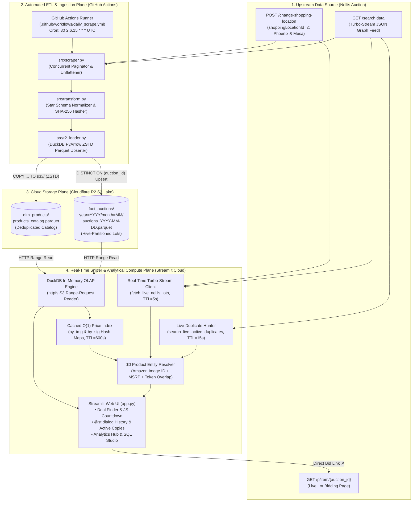
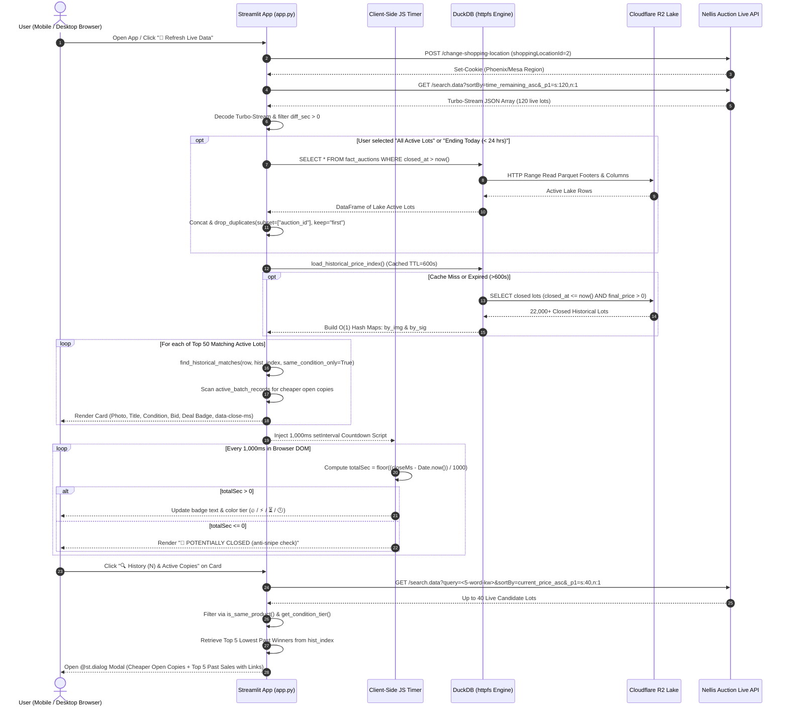
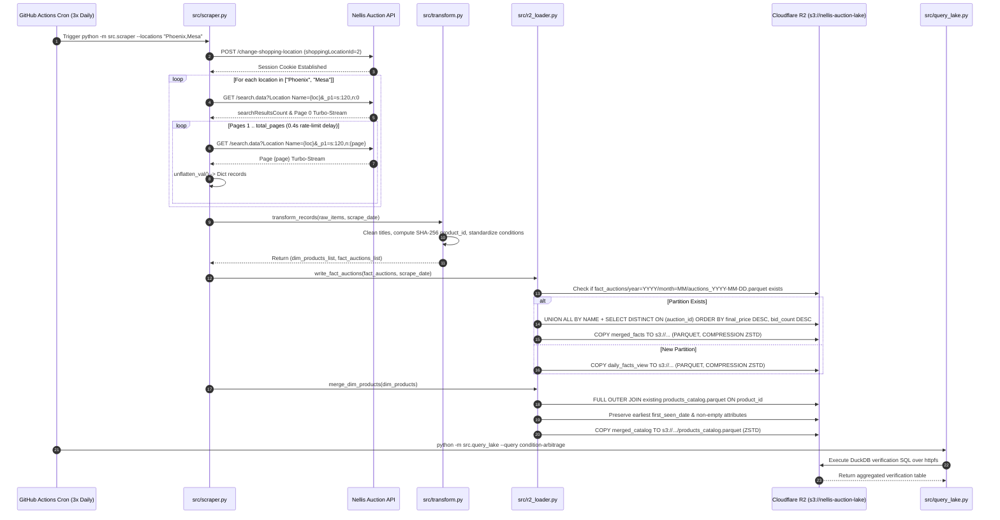
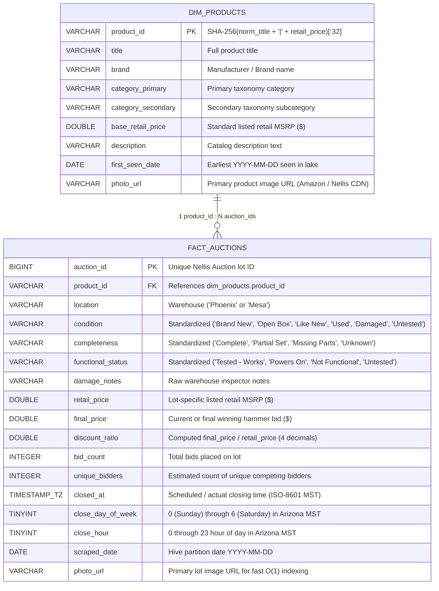
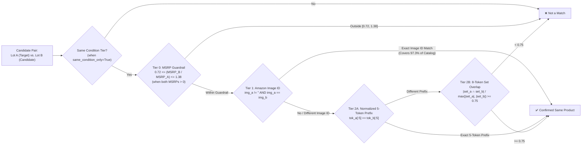
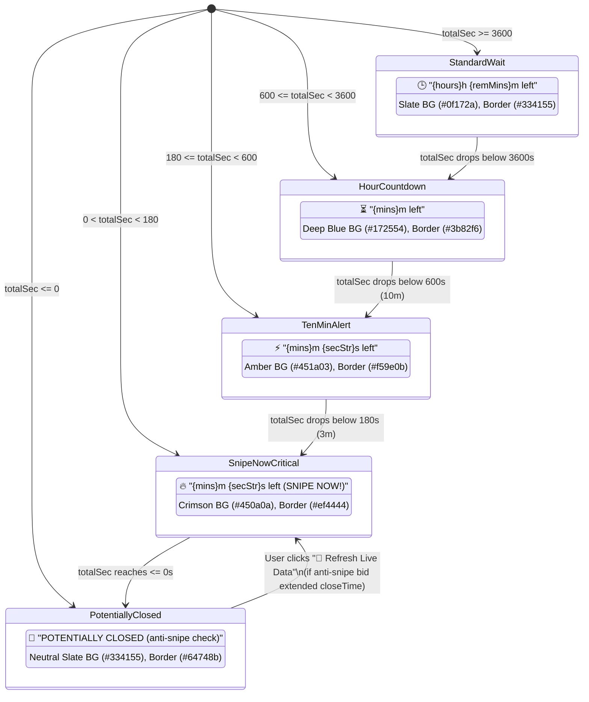

# Detailed Requirement Specification (DRS): Nellis Auction Data Lake, Analytics & Real-Time Deal Sniper Platform

| Document Attribute | Specification Value |
| :--- | :--- |
| **Document Title** | Nellis Auction Data Lake, Analytics & Real-Time Deal Sniper — Detailed Requirement Specification (DRS) |
| **Document Identifier** | `DRS-NELLIS-LAKE-2026-V3` |
| **Version** | `3.2.0 (Production Baseline)` |
| **Last Updated** | November 12, 2026 |
| **Operational Status** | Production — Active Cloud Deployment |
| **Target Marketplaces** | Nellis Auction (`https://www.nellisauction.com`) — **Phoenix, AZ** & **Mesa, AZ** Warehouses (`shoppingLocationId=2`) |
| **Primary Repository** | `https://github.com/angulofr/nellis-auction-scraper` (`main` branch, Public) |
| **Cloud Storage Backend** | Cloudflare R2 Object Storage (`s3://nellis-auction-lake`, Hive-Partitioned ZSTD Parquet) |
| **Analytical Query Engine** | DuckDB (`httpfs` S3 range-request execution engine) |
| **Application Runtime** | Streamlit Community Cloud ([app.py](file:///c:/Users/felix/Downloads/Random%20AG%20Requests/app.py)) |
| **Ingestion Orchestrator** | GitHub Actions Serverless Runners ([.github/workflows/daily_scrape.yml](file:///c:/Users/felix/Downloads/Random%20AG%20Requests/.github/workflows/daily_scrape.yml)) |
| **Monthly Operating Cost** | **$0.00 / month** (100% Free-Tier Serverless Architecture) |

---

## Table of Contents

1. [Executive Summary & Project Vision](#1-executive-summary--project-vision)
2. [Domain Glossary, Acronyms & Mathematical Definitions](#2-domain-glossary-acronyms--mathematical-definitions)
3. [System Architecture & Topology](#3-system-architecture--topology)
4. [Upstream Data Source & Protocol Specification (Nellis Auction API)](#4-upstream-data-source--protocol-specification-nellis-auction-api)
5. [Data Architecture, Star Schema & Storage Specification](#5-data-architecture-star-schema--storage-specification)
6. [Automated ETL Pipeline & Data Engineering Requirements](#6-automated-etl-pipeline--data-engineering-requirements)
7. [Zero-Cost ($0) Product Identity Resolution & Matching Engine](#7-zero-cost-0-product-identity-resolution--matching-engine)
8. [Real-Time Web Application Functional Requirements](#8-real-time-web-application-functional-requirements)
9. [Analytical Models, SQL Studio & CLI Query Engine](#9-analytical-models-sql-studio--cli-query-engine)
10. [Non-Functional Requirements (NFRs): Performance, Cost, Reliability & Security](#10-non-functional-requirements-nfrs-performance-cost-reliability--security)
11. [Deployment, Operations & Maintenance Runbook](#11-deployment-operations--maintenance-runbook)
12. [Requirements Traceability Matrix (RTM) & Future Roadmap](#12-requirements-traceability-matrix-rtm--future-roadmap)

---

## 1. Executive Summary & Project Vision

### 1.1 Purpose of This Document
This **Detailed Requirement Specification (DRS)** serves as the authoritative, end-to-end engineering source of truth for the **Nellis Auction Data Lake, Analytics & Real-Time Deal Sniper Platform**. It is written for software engineers, data engineers, quantitative analysts, and system maintainers onboarding to the project who require a complete understanding of:
- **Why** the system exists and the liquidation marketplace inefficiencies it exploits.
- **What** every subsystem, algorithm, SQL model, and user interface component does.
- **How** the system achieves real-time auction sniping, historical price benchmarking, cross-lot duplicate detection, and multi-million-row columnar analytics at **$0.00/month** in infrastructure and API costs.

Every functional requirement (`REQ-*`), non-functional requirement (`NFR-*`), data schema, wire-protocol decoder, entity-resolution heuristic, and UI state transition implemented in the production codebase is formally specified and linked to its implementation file and line range.

---

### 1.2 Problem Statement & Business Context
**Nellis Auction** (`nellisauction.com`) is a major regional retail return and overstock liquidation marketplace operating high-volume warehouses across the United States, including two major fulfillment warehouses in the Greater Phoenix metropolitan area: **Phoenix, AZ** and **Mesa, AZ**. Together, the Phoenix and Mesa warehouses turn over approximately **28,000 to 35,000 individual auction lots per day**.

While Nellis Auction offers significant discounts off retail MSRP (frequently 60%–95% off), individual buyers face five major structural disadvantages when browsing the native Nellis website or mobile app:

1. **Zero Historical Price Transparency (Ephemeral Catalog)**:
   Once an auction lot closes on Nellis Auction, it disappears from public search results within seconds. A buyer looking at a $300 DeWalt tool or Dyson vacuum currently sitting at $85 has no way of knowing through the native interface whether that exact item routinely sells for $40 on Tuesday afternoons or $140 on Sunday nights.
2. **Simultaneous Duplicate Inventory Fragmentation**:
   Because Nellis liquidates pallet-loads of identical retail returns, there are frequently **3 to 15 identical copies** of the exact same product open simultaneously across the Phoenix and Mesa warehouses, staggered by minutes or hours. One copy ending in 2 minutes may be bid up to $75 due to a bidding war, while an identical copy in the same condition ending 25 minutes later is sitting untouched at $12.
3. **Noisy, Inconsistent Warehouse Titles for Identical Products**:
   When warehouse inspectors check in inventory, they manually prepend free-text annotations to product titles—such as `***FACTORY SEALED***`, `[4 in 1]`, `(Broken Box Corner)`, or `**MISSING MANUAL**`—and occasionally truncate or alter descriptions. Naive exact-title matching fails to link past or active copies of the same underlying product.
4. **Condition & Functional Risk Asymmetry**:
   Liquidation lots vary from factory-sealed `Brand New (5/5)` items to `Open Box (4/5)`, `Used (3/5)`, and `Damaged / Missing Parts (1/5–2/5)`. Comparing the winning price of a broken/missing-parts item against a factory-sealed item leads to false deal signals unless comparisons enforce **like-for-like condition tiers**.
5. **Dynamic Anti-Sniping Timer Extensions ("Popcorn Bidding")**:
   Nellis Auction uses a dynamic anti-sniping mechanism: any bid placed within the final seconds of an auction automatically resets the countdown timer (typically back to 30–60 seconds). Buyers need a live, sub-second visual countdown that tracks the exact closing epoch millisecond and flags items that reach `0s` as **`🔴 POTENTIALLY CLOSED (anti-snipe check)`** until refreshed against the live API.

---

### 1.3 System Vision & Core Value Proposition
The **Nellis Auction Data Lake & Real-Time Deal Sniper** solves all five marketplace inefficiencies through a unified, mobile-friendly web application ([app.py](file:///c:/Users/felix/Downloads/Random%20AG%20Requests/app.py)) backed by an automated serverless data lake:

1. **Automated Historical Price Memory**: Continuously ingests, normalizes, and archives Phoenix and Mesa auction lots into a compressed Star Schema on Cloudflare R2 (`dim_products` + Hive-partitioned `fact_auctions`), building an ever-growing historical database of winning prices, bid counts, and closing times.
2. **Real-Time Live API Sniper**: Connects directly to Nellis Auction's internal Remix/React Router `turbo-stream` data endpoints (`/search.data`) to fetch up-to-the-second bids, closing timestamps, and anti-snipe extensions in ~250ms.
3. **$0-Cost Multi-Tier Product Entity Resolution**: Links identical products across past and active lots—despite noisy title modifications—by combining **Amazon Catalog Barcode Image Fingerprinting** (covering **97.3%** of all Nellis lots), **Retail MSRP Guardrails (±28%)**, and **Normalized Token Signature Overlap**, strictly segmented by **Like-for-Like Condition Tiers**.
4. **Instant On-Card Deal Verdict & Cheaper Active Copy Alerts**: Every active lot card immediately tells the user:
   - The **Cheapest Historical Winning Price** and **Average Winning Price** for that exact product in that exact condition tier.
   - A visual **Deal Verdict Badge** (`🟢 Below All-Time Low!`, `🟢 Below Avg Winning Price`, or `🔴 Above Avg`).
   - An instant **Cheaper Active Copies Alert** (`💡 N Cheaper Open (From $X)!`) if identical items are open right now for less money.
5. **Interactive History & Active Arbitrage Modal (`@st.dialog`)**: Clicking **`🔍 History & Active Copies`** on any card opens an overlay dialog that queries Nellis Live Search in real time to list all currently open copies sorted from lowest bid to highest, alongside the **Top 5 Lowest Historical Winning Lots** with direct clickable links (`https://www.nellisauction.com/p/item/{id}`) to verify every past sale on Nellis Auction.

---

### 1.4 The Zero-Cost ($0/Month) Architectural Mandate
> [!IMPORTANT]
> **Hard Architectural Constraint**: Every component of the system—data ingestion, object storage, analytical query processing, entity resolution, and web hosting—must operate strictly within **100% free-tier cloud allocations ($0.00/month)** without requiring paid LLM/embedding APIs, dedicated database servers, or paid compute instances.

| Architectural Layer | Technology Selected | Free-Tier Allocation | System Resource Utilization | Monthly Cost |
| :--- | :--- | :--- | :--- | :--- |
| **Scheduled ETL Compute** | GitHub Actions (`ubuntu-latest`) | Unlimited minutes on Public Repositories | ~3 runs/day × ~4 mins/run = ~360 mins/month | **$0.00** |
| **Cloud Data Lake Storage** | Cloudflare R2 Object Storage | 10 GB storage/month, 10M Class B reads, 1M Class A writes, **0 egress fees** | ~2–3 MB/day ZSTD Parquet (~0.9 GB/year, <10% of free tier) | **$0.00** |
| **Analytical SQL Engine** | DuckDB (`httpfs` extension) | Open-source in-process columnar OLAP engine | Runs in-memory inside Streamlit & GitHub runners | **$0.00** |
| **Product Matching / AI** | Deterministic Barcode Image ID + Token Jaccard Engine | Custom Python algorithm in [app.py](file:///c:/Users/felix/Downloads/Random%20AG%20Requests/app.py#L70-L182) | Zero external API calls; 97.3% barcode image coverage | **$0.00** |
| **Web Application Hosting** | Streamlit Community Cloud | Free hosting for public GitHub apps | 1 app instance connected to `angulofr/nellis-auction-scraper` | **$0.00** |

---

### 1.5 Evolution from Local SQLite Prototype to Serverless Cloud Lakehouse
The repository preserves both the initial local prototype utilities and the production cloud lakehouse modules:
- **Phase 1 (Legacy Local Prototype)**: Consisted of [nellis_scraper.py](file:///c:/Users/felix/Downloads/Random%20AG%20Requests/nellis_scraper.py), [dashboard.py](file:///c:/Users/felix/Downloads/Random%20AG%20Requests/dashboard.py), and [query_db.py](file:///c:/Users/felix/Downloads/Random%20AG%20Requests/query_db.py) backed by a monolithic local SQLite file (`nellis_auctions.db`). While effective on a single desktop, SQLite could not scale to multi-month cloud storage or mobile access without hosting a paid VPS.
- **Phase 2 (Serverless Cloud Lakehouse)**: Introduced the modular `src/` pipeline ([src/scraper.py](file:///c:/Users/felix/Downloads/Random%20AG%20Requests/src/scraper.py), [src/transform.py](file:///c:/Users/felix/Downloads/Random%20AG%20Requests/src/transform.py), [src/r2_loader.py](file:///c:/Users/felix/Downloads/Random%20AG%20Requests/src/r2_loader.py), [src/query_lake.py](file:///c:/Users/felix/Downloads/Random%20AG%20Requests/src/query_lake.py)) normalizing records into a deduplicated Star Schema stored as ZSTD-compressed Parquet on Cloudflare R2, paired with the cloud-native [app.py](file:///c:/Users/felix/Downloads/Random%20AG%20Requests/app.py) Streamlit interface.
- **Phase 3 (Real-Time Sniper & Entity Resolution)**: Integrated direct sub-second Nellis `turbo-stream` live querying, client-side JavaScript ticking countdowns, like-for-like historical deal benchmarking, and real-time cheaper active duplicate discovery into [app.py](file:///c:/Users/felix/Downloads/Random%20AG%20Requests/app.py).

---

## 2. Domain Glossary, Acronyms & Mathematical Definitions

### 2.1 Domain Terminology & Acronyms

| Term / Acronym | Definition in the Context of This System |
| :--- | :--- |
| **Lot (`auction_id`)** | A single physical item put up for bid on Nellis Auction. Assigned a unique monotonically increasing 8-digit integer ID (e.g., `62489102`). |
| **Product (`product_id`)** | The abstract underlying retail catalog item (e.g., *"Dyson V8 Origin Cordless Vacuum"*). Multiple distinct `auction_id` lots map to a single `product_id`. |
| **Retail MSRP (`retail_price`)** | The estimated original retail price (in USD) listed by Nellis Auction for the lot, sourced from Amazon/retail barcode lookup. |
| **Current / Final Price (`final_price`)** | For active lots, the current highest bid in USD; for closed lots, the final winning hammer price in USD (excluding buyer's premium and sales tax). |
| **Buyer's Premium** | A 15% fee charged by Nellis Auction on top of the winning hammer price. |
| **Anti-Snipe Extension** | Nellis Auction's rule that extends an item's `closeTime` whenever a new bid is placed within the final seconds of the auction. |
| **`POTENTIALLY CLOSED`** | The UI state displayed when an item's client-side countdown reaches `<= 0` seconds. Because another bidder may have triggered an anti-snipe extension since the page was loaded, the lot is marked `POTENTIALLY CLOSED (anti-snipe check)` until live data is refreshed. |
| **Shopping Location ID (`2`)** | Nellis Auction's internal region identifier (`shoppingLocationId=2`) representing the Greater Phoenix, AZ metro area (covering both the **Phoenix** and **Mesa** warehouses). |
| **Turbo-Stream (`search.data`)** | The Remix / React Router v7 single-fetch wire format used by Nellis Auction's `/search.data` endpoint, which serializes object graphs as a flat JSON array with integer pointer references. |
| **Amazon Image ID (`img_id`)** | The unique alphanumeric media identifier embedded in Amazon catalog image URLs (`/images/I/<ID>.jpg`), generated when Nellis warehouse workers scan a product's UPC/EAN/ASIN barcode. |
| **Condition Tier (`cond_tier`)** | One of four standardized quality buckets (`New`, `Open Box / Like New`, `Used`, `Damaged`) used to enforce strict like-for-like price comparisons. |
| **Hive Partitioning** | A directory naming convention (`year=YYYY/month=MM/auctions_YYYY-MM-DD.parquet`) that enables DuckDB to skip reading irrelevant files via partition pruning. |

---

### 2.2 Core Mathematical Definitions & Formulas

#### 1. Discount Ratio ($R_{\text{disc}}$)
Stored in `fact_auctions.discount_ratio` to represent the fraction of retail MSRP paid by the winning bidder:

$$R_{\text{disc}} = \begin{cases} \text{round}\left(\dfrac{P_{\text{final}}}{P_{\text{retail}}}, 4\right) & \text{if } P_{\text{retail}} > 0 \text{ and } P_{\text{final}} \ge 0 \\ \text{NULL} & \text{otherwise} \end{cases}$$

Where $P_{\text{final}}$ is `final_price` and $P_{\text{retail}}$ is `retail_price`. For example, an item with $P_{\text{retail}} = \$200.00$ and $P_{\text{final}} = \$30.00$ has $R_{\text{disc}} = 0.1500$.

#### 2. Discount Percentage ($D_{\%}$)
Displayed in the UI (`discount_pct`) to show the percentage savings off retail MSRP:

$$D_{\%} = \begin{cases} \text{round}\left(\left(1.0 - \dfrac{P_{\text{final}}}{P_{\text{retail}}}\right) \times 100.0, 1\right) & \text{if } P_{\text{retail}} > 0 \text{ and } P_{\text{final}} \le P_{\text{retail}} \\ 0.0\% & \text{otherwise} \end{cases}$$

#### 3. Remaining Time Delta ($\Delta t_{\text{sec}}$)
Computed both server-side in Python (`diff_sec`) and client-side every 1,000ms in JavaScript:

$$\Delta t_{\text{sec}} = \frac{T_{\text{close, ms}} - T_{\text{now, ms}}}{1000.0}$$

Where $T_{\text{close, ms}}$ is the UTC epoch millisecond timestamp of the lot's scheduled close (`closeTime`) and $T_{\text{now, ms}}$ is the current UTC epoch millisecond timestamp.

#### 4. Estimated Unique Competing Bidders ($B_{\text{unique}}$)
When exact per-bidder telemetry is not exposed by the summary feed, `src/transform.py` estimates unique competing bidders from total `bid_count` ($N_{\text{bids}}$):

$$B_{\text{unique}} = \begin{cases} \min\left(N_{\text{bids}}, \max\left(1, \lfloor 0.65 \times N_{\text{bids}} \rfloor\right)\right) & \text{if } N_{\text{bids}} > 0 \\ 0 & \text{if } N_{\text{bids}} = 0 \end{cases}$$

#### 5. Retail MSRP Guardrail Ratio ($R_{\text{msrp}}$)
When evaluating whether Lot $A$ and Lot $B$ represent the same underlying product in `is_same_product()`, their retail MSRPs must satisfy:

$$0.72 \le \frac{\text{MSRP}_B}{\text{MSRP}_A} \le 1.38 \quad \text{(when } \text{MSRP}_A > 0 \text{ and } \text{MSRP}_B > 0\text{)}$$

This asymmetric $[0.72, 1.38]$ window (corresponding to $\approx \pm 28\%$ multiplicative tolerance, since $1 / 0.72 \approx 1.388$) prevents matching different size/capacity variants (e.g., a 2-pack vs. a 10-pack sharing a stock photo) while accommodating minor retail price fluctuations across Amazon listings.

#### 6. Normalized Token Overlap Score ($S_{\text{overlap}}$)
For two normalized 8-token sets $T_A$ and $T_B$ extracted by `normalize_title_tokens()`:

$$S_{\text{overlap}}(T_A, T_B) = \frac{|T_A \cap T_B|}{\max(|T_A|, |T_B|)}$$

Two lots without matching Amazon Image IDs or identical 5-token prefixes are classified as the same product if and only if $S_{\text{overlap}}(T_A, T_B) \ge 0.75$ and the MSRP guardrail passes.

---

## 3. System Architecture & Topology

### 3.1 High-Level Serverless Lakehouse Architecture

The platform is architected as a four-plane serverless system combining a **scheduled batch Lakehouse pipeline** (for historical price memory and OLAP analytics) with a **direct low-latency live API stream** (for real-time auction sniping and active duplicate discovery).



---

### 3.2 Four-Plane Separation of Concerns

1. **Upstream Source Plane (`nellisauction.com`)**:
   Serves both the bulk regional catalog (`Phoenix` and `Mesa`) and real-time filtered queries (`sortBy=time_remaining_asc`, `sortBy=current_price_asc`, `query=<keywords>`).
2. **Automated ETL & Ingestion Plane (`GitHub Actions` + `src/`)**:
   Executes three times daily (`02:30`, `06:30`, and `15:30` UTC — corresponding to `7:30 PM`, `11:30 PM`, and `8:30 AM` Arizona MST). Paginates through all active and recently closed Phoenix and Mesa lots, normalizes condition/completeness/functionality attributes, computes deterministic `product_id` hashes, and performs idempotent upserts into Cloudflare R2.
3. **Cloud Storage Plane (`Cloudflare R2`)**:
   Stores the Star Schema in Apache Parquet format compressed with Zstandard (`ZSTD`). Separating verbose text metadata (`dim_products`) from numeric transactional metrics (`fact_auctions`) reduces daily storage growth by **~60%**.
4. **Real-Time Sniper & Analytical Compute Plane (`Streamlit Cloud` + `DuckDB`)**:
   Executes [app.py](file:///c:/Users/felix/Downloads/Random%20AG%20Requests/app.py), combining sub-second live API reads with a cached in-memory historical index (`load_historical_price_index()`) hydrated via DuckDB `httpfs` from Cloudflare R2.

---

### 3.3 Hybrid Dual-Path Data Flow (Cold/Warm Lake vs. Hot Live Stream)

A defining architectural feature of [app.py](file:///c:/Users/felix/Downloads/Random%20AG%20Requests/app.py) is its **Hybrid Dual-Path Data Architecture**:

| Data Path | Source | Latency / Cache TTL | Primary Responsibility |
| :--- | :--- | :--- | :--- |
| **Hot Path (Live Stream)** | Direct HTTP requests to `https://www.nellisauction.com/search.data` | ~250ms network latency; cached for `ttl=5s` (`fetch_live_nellis_lots`) and `ttl=15s` (`search_live_active_duplicates`) | Provides up-to-the-second current bid amounts, exact `closeTime` epoch milliseconds (reflecting any anti-snipe extensions), and real-time open duplicate discovery. |
| **Warm Path (Active Lake Union)** | DuckDB `httpfs` query over `s3://nellis-auction-lake/fact_auctions/*/*/*.parquet` where `closed_at > now()` | ~150–400ms query execution | Expands coverage when the user selects `"All Active Lots"` or `"📅 Ending Today (< 24 hrs)"` by unioning active lake records with the live stream and deduplicating on `auction_id` (`keep="first"` so live bid prices always win). |
| **Cold Path (Historical Price Index & OLAP)** | DuckDB `httpfs` query over `fact_auctions` joined with `dim_products` where `closed_at <= now() AND final_price > 0` | Hydrated once every 10 minutes (`@st.cache_data(ttl=600)`); O(1) dictionary lookup (<1ms per item card) | Powers the on-card `🏆 Cheapest Won` / `Avg` badges, deal verdicts, the `@st.dialog` Top-5 lowest historical winners list, the 4 Analytical Hub models, and SQL Studio. |

---

### 3.4 End-to-End Sequence Diagram: User Interaction, Live Sniping & Modal Inspection



---

### 3.5 End-to-End Sequence Diagram: Automated CI/CD Ingestion & R2 Upsert Pipeline



---

### 3.6 Repository File & Module Map

The table below catalogs every file belonging to the Nellis Auction platform, its architectural role, and its operational status:

| File Path | Architectural Layer | Operational Status | Description & Responsibilities |
| :--- | :--- | :--- | :--- |
| [app.py](file:///c:/Users/felix/Downloads/Random%20AG%20Requests/app.py) | Presentation, Sniper & Matching Engine | **Primary Production Entrypoint** | 1,086-line Streamlit cloud application implementing the Deal Finder, Live Turbo-Stream Sniper, $0 Product Entity Resolver, `@st.dialog` Price History & Active Copies Modal, JS Ticking Countdowns, Analytics Hub, and SQL Studio. |
| [src/scraper.py](file:///c:/Users/felix/Downloads/Random%20AG%20Requests/src/scraper.py) | ETL Ingestion Module | **Production Pipeline** | Paginated multi-location scraper (`Phoenix`, `Mesa`) that initializes the location cookie, decodes `turbo-stream` payloads, and orchestrates transformation and R2 loading. |
| [src/transform.py](file:///c:/Users/felix/Downloads/Random%20AG%20Requests/src/transform.py) | ETL Transformation Module | **Production Pipeline** | Normalizes raw scraped items into Star Schema records (`dim_products` and `fact_auctions`), computes deterministic 32-char SHA-256 `product_id` keys, converts timestamps to Arizona MST (`UTC-7`), and standardizes condition/completeness/functionality. |
| [src/r2_loader.py](file:///c:/Users/felix/Downloads/Random%20AG%20Requests/src/r2_loader.py) | Cloud Storage Loader | **Production Pipeline** | Uses DuckDB `httpfs` and PyArrow to write ZSTD-compressed Hive-partitioned Parquet files to Cloudflare R2 (`s3://nellis-auction-lake`), performing idempotent upserts on `auction_id` and `product_id`. |
| [src/query_lake.py](file:///c:/Users/felix/Downloads/Random%20AG%20Requests/src/query_lake.py) | CLI Analytical Query Tool | **Production CLI & CI Verifier** | Command-line tool and interactive DuckDB shell (`duckdb-r2>`) for executing preset analytical models or custom SQL against R2 or local Parquet files. Used by GitHub Actions to verify each ingestion run. |
| [queries/analytics.sql](file:///c:/Users/felix/Downloads/Random%20AG%20Requests/queries/analytics.sql) | Analytical SQL Library | **Production Reference** | Standalone SQL definitions for the 4 core analytical models (Category Spreads, Condition Risk Arbitrage, Temporal Sweet Spots, and Sleeper Lot Hunter). |
| [.github/workflows/daily_scrape.yml](file:///c:/Users/felix/Downloads/Random%20AG%20Requests/.github/workflows/daily_scrape.yml) | CI/CD Orchestration | **Production Workflow** | GitHub Actions workflow running 3× daily (`cron: '30 2,6,15 * * *'`) and on manual `workflow_dispatch` to ingest Phoenix & Mesa lots into Cloudflare R2. |
| [requirements.txt](file:///c:/Users/felix/Downloads/Random%20AG%20Requests/requirements.txt) | Dependency Manifest | **Production Manifest** | Python package dependencies (`streamlit>=1.30.0`, `duckdb>=0.9.0`, `pyarrow>=14.0.0`, `pandas>=2.0.0`, `boto3>=1.30.0`, `pynacl>=1.5.0`, `pytz>=2024.1`). |
| [README.md](file:///c:/Users/felix/Downloads/Random%20AG%20Requests/README.md) | Documentation | **Production Overview** | Quick-start architectural overview and CLI usage documentation. |
| [nellis_scraper.py](file:///c:/Users/felix/Downloads/Random%20AG%20Requests/nellis_scraper.py) | Legacy Local Scraper | Legacy / Local Utility | Original standalone SQLite scraper and `--finalize` updater writing to local `nellis_auctions.db`. |
| [dashboard.py](file:///c:/Users/felix/Downloads/Random%20AG%20Requests/dashboard.py) | Legacy Local Dashboard | Deprecated (Replaced by `app.py`) | Local-only SQLite Streamlit prototype. Superseded by cloud-native [app.py](file:///c:/Users/felix/Downloads/Random%20AG%20Requests/app.py). |
| [query_db.py](file:///c:/Users/felix/Downloads/Random%20AG%20Requests/query_db.py) | Legacy Local CLI | Legacy / Local Utility | CLI query helper for the local `nellis_auctions.db` SQLite database. |

---

## 4. Upstream Data Source & Protocol Specification (Nellis Auction API)

### 4.1 Upstream Endpoints

Nellis Auction's web platform is built on **Remix / React Router v7** using Single-Fetch `turbo-stream` data loaders. The platform interacts with three upstream endpoints on `https://www.nellisauction.com`:

| Endpoint | HTTP Method | Content-Type / Payload | Purpose |
| :--- | :--- | :--- | :--- |
| `/change-shopping-location` | `POST` | `application/x-www-form-urlencoded`<br>`shoppingLocationId=2&referrer=%2F` | Initializes the HTTP session cookies binding subsequent search queries to the **Phoenix, AZ** metropolitan region (which encompasses both the Phoenix and Mesa warehouses). |
| `/search.data` | `GET` | URL Query Parameters (`Location Name`, `query`, `sortBy`, `_p1`) | Returns a Remix `turbo-stream` flat JSON array containing `searchResultsCount` and up to 120 serialized product lot objects per page. |
| `/p/item/{auction_id}` | `GET` | Browser Navigation / HTML or `.data` loader | Canonical public URL for viewing and placing bids on a specific auction lot (both active and closed historical lots remain accessible by ID). |

---

### 4.2 Session & Cookie State Management
> [!WARNING]
> **Critical Protocol Requirement**: Calling `GET /search.data` without first establishing a cookie session via `POST /change-shopping-location` with `shoppingLocationId=2` causes Nellis Auction to default to its Las Vegas, NV catalog or return empty location filters for Phoenix/Mesa.

Both [src/scraper.py](file:///c:/Users/felix/Downloads/Random%20AG%20Requests/src/scraper.py#L29-L52) (`get_authenticated_session()`) and [app.py](file:///c:/Users/felix/Downloads/Random%20AG%20Requests/app.py#L357-L363) (`fetch_live_nellis_lots()` / `search_live_active_duplicates()`) instantiate a `urllib.request.HTTPCookieProcessor` opener and execute:
```http
POST https://www.nellisauction.com/change-shopping-location HTTP/1.1
User-Agent: Mozilla/5.0
Content-Type: application/x-www-form-urlencoded

shoppingLocationId=2
```
The resulting `Set-Cookie` header is automatically persisted in memory by `HTTPCookieProcessor` for subsequent `GET /search.data` calls within that session.

---

### 4.3 Query Parameter Specification (`GET /search.data`)

The `/search.data` endpoint accepts the following query parameters:

| Parameter Name | Format / Allowed Values | Behavior & System Usage |
| :--- | :--- | :--- |
| `Location Name` | `"Phoenix"` or `"Mesa"` | Filters catalog results to a single warehouse. When omitted (while `shoppingLocationId=2` cookie is active), returns lots from **both** Phoenix and Mesa warehouses. |
| `query` | Free-text string (e.g., `"DeWalt"`, `"Eagle Health Supplies Tub Transfer"`) | Performs server-side full-text search across active Nellis lots. Used by both user keyword search (`search_kw`) and the real-time duplicate hunter (`search_live_active_duplicates`). *Note: Nellis strictly requires the parameter name `query` (not `q` or `search`).* |
| `sortBy` | `"time_remaining_asc"`<br>`"current_price_asc"`<br>`"retail_price_desc"` | Controls server-side sort order before pagination:<br>• `time_remaining_asc`: Used for sniper mode (lots closing in seconds/minutes).<br>• `current_price_asc`: Used when sorting by lowest bid or hunting for the cheapest active copies.<br>• `retail_price_desc`: Used when sorting by highest retail MSRP. |
| `_p1` | `s:{page_size},n:{page_num}` (e.g., `s:120,n:1` or `s:120,n:0`) | Controls pagination batch size (`s`, max `120`) and page index (`n`). |

---

### 4.4 React Router v7 / Remix `turbo-stream` Flat-Array Wire Format Specification

Unlike standard REST APIs that return nested JSON objects, `/search.data` returns a **flat top-level JSON array** (`list`) where strings, primitives, lists, and dictionaries are deduplicated by index position.

#### Wire Format Rules:
1. **Top-Level Structure**: The response payload `data` is a JSON array `data[0 ... N-1]`.
2. **Dictionary Key & Value Indirection (`_k`: `v`)**:
   Inside any dictionary element `data[idx]`, keys are prefixed with an underscore followed by the integer index of the key string in `data`, and values are integer indices pointing to another position in `data`:
   ```json
   {
     "_14": 15,
     "_16": 17
   }
   ```
   Here, `"_14"` means `key = data[14]` (e.g., `"id"`), and `15` means `value = data[15]` (e.g., `62489102`).
3. **Date Tuple Encoding (`["D", epoch_ms]`)**:
   Timestamps (such as `closeTime` and `openTime`) are serialized as a 2-element JSON array where element `0` is the literal string `"D"` and element `1` is the 64-bit integer UTC epoch millisecond timestamp:
   ```json
   ["D", 1794457556211]
   ```
4. **Root Entry Points**:
   - Searching `data` for the literal string `"searchResultsCount"` at index `i` yields the integer total item count at `data[i + 1]`.
   - Searching `data` for the literal string `"products"` at index `i` yields a list of integer indices at `data[i + 1]`, where each integer index points to a root product dictionary inside `data`.

---

### 4.5 Recursive Pointer Resolution & Graph Unflattening Algorithm (`unflatten_val`)

Implemented in [app.py](file:///c:/Users/felix/Downloads/Random%20AG%20Requests/app.py#L268-L293) and [src/scraper.py](file:///c:/Users/felix/Downloads/Random%20AG%20Requests/src/scraper.py#L55-L98), the `unflatten_val(idx, data)` algorithm reconstructs standard nested Python dictionaries from the flat array:

```python
def unflatten_val(idx, data):
    """Decode Turbo-Stream JSON graph indices."""
    if not isinstance(idx, int) or idx < 0 or idx >= len(data):
        return None
    val = data[idx]
    if isinstance(val, (int, float, str, bool)) or val is None:
        return val
    if isinstance(val, list):
        # Special case: Remix Turbo-Stream Date tuple ["D", 1794457556211]
        if len(val) == 2 and val[0] == 'D' and isinstance(val[1], (int, float)):
            return val[1]
        return [unflatten_val(i, data) for i in val]
    if isinstance(val, dict):
        res = {}
        for k, v in val.items():
            key = k
            if k.startswith("_"):
                try:
                    k_idx = int(k[1:])
                    if 0 <= k_idx < len(data):
                        key = str(data[k_idx])
                except ValueError:
                    pass
            res[key] = unflatten_val(v, data)
        return res
    return val
```

#### Decoded Product Object Structure
Once unflattened, each product dictionary `p` contains the following nested structure:
```json
{
  "id": 62489102,
  "title": "Eagle Health Supplies Tub Transfer Bench with Swivel Seat",
  "retailPrice": 350.0,
  "currentPrice": 36.0,
  "bidCount": 10,
  "isClosed": false,
  "closeTime": 1794457920000,
  "notes": "Factory sealed box",
  "location": {
    "id": 4,
    "name": "Mesa"
  },
  "grade": {
    "categoryType": null,
    "assemblyType": {"id": 2, "description": "No"},
    "missingPartsType": {"id": 6, "description": "No"},
    "functionalType": {"id": 1, "description": "Yes"},
    "conditionType": {"id": 5, "description": "New"},
    "damageType": {"id": 7, "description": "None"},
    "packageType": {"id": 5, "description": "Yes"},
    "rating": 5
  },
  "photos": [
    {
      "url": "https://m.media-amazon.com/images/I/61xYzAbCdEL._AC_SL1500_.jpg"
    }
  ]
}
```

---

## 5. Data Architecture, Star Schema & Storage Specification

### 5.1 Star Schema Entity-Relationship Model

To minimize storage footprint on Cloudflare R2 and maximize DuckDB vectorized scan performance, the data lake separates static product metadata (`dim_products`) from transactional auction lot metrics (`fact_auctions`) in a **Star Schema**:



---

### 5.2 Dimension Table Specification: `dim_products`

Stored at `s3://nellis-auction-lake/dim_products/products_catalog.parquet` (and locally mirrored at `data_lake/dim_products/products_catalog.parquet`). Enforced in [src/transform.py](file:///c:/Users/felix/Downloads/Random%20AG%20Requests/src/transform.py#L173-L185) and [src/r2_loader.py](file:///c:/Users/felix/Downloads/Random%20AG%20Requests/src/r2_loader.py#L139-L220).

| # | Column Name | DuckDB / Parquet Type | Pandas Type | Nullable | Derivation & Business Rules |
| :--- | :--- | :--- | :--- | :--- | :--- |
| 1 | `product_id` | `VARCHAR` (PK) | `string` | `NOT NULL` | First 32 hex characters of `SHA-256(f"{normalize_title(title)}\|{retail_price:.2f}")`. |
| 2 | `title` | `VARCHAR` | `string` | `NOT NULL` | Original product title string from Nellis catalog (`"Untitled"` fallback). |
| 3 | `brand` | `VARCHAR` | `string` | `NOT NULL` | Brand attribute if provided by upstream feed; `""` empty string otherwise. |
| 4 | `category_primary` | `VARCHAR` | `string` | `NOT NULL` | `category` or `taxonomyLevel1` from upstream feed; `""` fallback. |
| 5 | `category_secondary`| `VARCHAR` | `string` | `NOT NULL` | `subcategory` or `taxonomyLevel2` from upstream feed; `""` fallback. |
| 6 | `base_retail_price` | `DOUBLE` | `float64` | `NOT NULL` | Listed retail MSRP rounded to 2 decimal places (`0.0` fallback). |
| 7 | `description` | `VARCHAR` | `string` | `NOT NULL` | Full catalog description (`catalog_description` or `description`); `""` fallback. |
| 8 | `first_seen_date` | `DATE` | `date` | `NOT NULL` | Date (`YYYY-MM-DD`) when this `product_id` was first ingested into the lake. Preserved immutably across subsequent `FULL OUTER JOIN` merges via `COALESCE(o.first_seen_date, n.first_seen_date)`. |
| 9 | `photo_url` | `VARCHAR` | `string` | `NOT NULL` | URL of the primary product photograph (`photos[0]['url']`). |

---

### 5.3 Fact Table Specification: `fact_auctions`

Stored in Hive-partitioned paths at `s3://nellis-auction-lake/fact_auctions/year=YYYY/month=MM/auctions_YYYY-MM-DD.parquet`. Enforced in [src/transform.py](file:///c:/Users/felix/Downloads/Random%20AG%20Requests/src/transform.py#L151-L171) and [src/r2_loader.py](file:///c:/Users/felix/Downloads/Random%20AG%20Requests/src/r2_loader.py#L51-L136).

| # | Column Name | DuckDB / Parquet Type | Pandas Type | Nullable | Derivation & Business Rules |
| :--- | :--- | :--- | :--- | :--- | :--- |
| 1 | `auction_id` | `BIGINT` (PK) | `int64` | `NOT NULL` | Unique Nellis Auction lot ID (`item['id']`). Deduplication key within each daily partition. |
| 2 | `product_id` | `VARCHAR` (FK) | `string` | `NOT NULL` | Foreign key referencing `dim_products.product_id`. |
| 3 | `location` | `VARCHAR` | `string` | `NOT NULL` | Warehouse location name: `"Phoenix"` or `"Mesa"`. |
| 4 | `condition` | `VARCHAR` | `string` | `NOT NULL` | Standardized via `standardize_condition()`: `"Brand New"`, `"Open Box"`, `"Like New"`, `"Used"`, `"Damaged"`, or `"Untested"`. |
| 5 | `completeness` | `VARCHAR` | `string` | `NOT NULL` | Standardized via `standardize_completeness()`: `"Complete"`, `"Partial Set"`, `"Missing Parts"`, or `"Unknown"`. |
| 6 | `functional_status`| `VARCHAR` | `string` | `NOT NULL` | Standardized via `standardize_functionality()`: `"Tested - Works"`, `"Powers On"`, `"Not Functional"`, or `"Untested"`. |
| 7 | `damage_notes` | `VARCHAR` | `string` | `NOT NULL` | Trimmed inspector notes (`notes` or `inspector_notes`), e.g., `"Box slightly crushed"`. |
| 8 | `retail_price` | `DOUBLE` | `float64` | `NOT NULL` | Retail MSRP in USD rounded to 2 decimal places. |
| 9 | `final_price` | `DOUBLE` | `float64` | `NOT NULL` | Winning hammer price (or latest observed bid) in USD rounded to 2 decimal places. |
| 10 | `discount_ratio` | `DOUBLE` | `float64` | `NULLABLE` | `round(final_price / retail_price, 4)` when `retail_price > 0`; `NULL` otherwise. |
| 11 | `bid_count` | `INTEGER` | `int32` | `NOT NULL` | Total number of bids placed (`bidCount`). |
| 12 | `unique_bidders` | `INTEGER` | `int32` | `NOT NULL` | Estimated unique competing bidders (`min(bid_count, max(1, int(bid_count * 0.65)))`). |
| 13 | `closed_at` | `TIMESTAMP WITH TIME ZONE` | `datetime64[ns, MST]` | `NULLABLE` | Exact closing timestamp converted to Arizona MST (`UTC-7`). |
| 14 | `close_day_of_week`| `TINYINT` | `Int8` | `NULLABLE` | Day of week in Arizona MST: `0` = Sunday, `1` = Monday, ..., `6` = Saturday (`(weekday() + 1) % 7`). |
| 15 | `close_hour` | `TINYINT` | `Int8` | `NULLABLE` | Hour of day (`0`–`23`) in Arizona MST when the lot closes. |
| 16 | `scraped_date` | `DATE` | `date` | `NOT NULL` | Partition date `YYYY-MM-DD` in Arizona MST. |
| 17 | `photo_url` | `VARCHAR` | `string` | `NOT NULL` | Primary image URL (`photos[0]['url']`), denormalized onto `fact_auctions` for single-pass O(1) image-ID indexing. |

---

### 5.4 Cloud Storage Layout, Compression & Capacity Math

All Parquet files are written using DuckDB's `COPY ... TO ... (FORMAT 'PARQUET', COMPRESSION 'ZSTD')`:

```text
s3://nellis-auction-lake/
├── dim_products/
│   └── products_catalog.parquet                 (~1.4 MB compressed for 20,000+ unique products)
└── fact_auctions/
    └── year=2026/
        └── month=11/
            ├── auctions_2026-11-11.parquet      (~1.8 MB compressed for 28,178 auction lots)
            ├── auctions_2026-11-12.parquet
            └── ...
```

#### Capacity & Free-Tier Sustainability Calculation:
- **Daily Raw Payload**: ~30,000 lots × ~1.5 KB JSON/lot $\approx 45\text{ MB/day}$ uncompressed JSON.
- **Daily Star-Schema ZSTD Parquet**: Dictionary encoding on `location`, `condition`, `completeness`, and `functional_status` plus ZSTD compression reduces each daily `fact_auctions` file to **~1.8–2.5 MB/day**.
- **Annual Storage Footprint**: $2.2\text{ MB/day} \times 365\text{ days} \approx 803\text{ MB/year}$ (plus ~15 MB for `dim_products`), totaling **< 0.85 GB/year**—less than **8.5%** of Cloudflare R2's 10 GB/month free tier, allowing **10+ years of continuous retention at $0.00 cost**.


---

## 6. Automated ETL Pipeline & Data Engineering Requirements

### 6.1 Functional Requirements: Scraper & Paginator ([src/scraper.py](file:///c:/Users/felix/Downloads/Random%20AG%20Requests/src/scraper.py))

| Requirement ID | Priority | Requirement Specification | Implementation Reference |
| :--- | :--- | :--- | :--- |
| **`REQ-ING-001`** | Mandatory | **Regional Session Initialization**: The scraper SHALL initialize an HTTP cookie jar via `POST https://www.nellisauction.com/change-shopping-location` with payload `shoppingLocationId=2&referrer=%2F` and a 15-second timeout before issuing any catalog search requests. | [src/scraper.py](file:///c:/Users/felix/Downloads/Random%20AG%20Requests/src/scraper.py#L29-L52) |
| **`REQ-ING-002`** | Mandatory | **Multi-Warehouse Iteration**: By default, the scraper SHALL iterate sequentially over the `Phoenix` and `Mesa` warehouse locations (`--locations "Phoenix,Mesa"`), tagging every extracted dictionary with `item["location_name"] = loc`. | [src/scraper.py](file:///c:/Users/felix/Downloads/Random%20AG%20Requests/src/scraper.py#L143-L189) |
| **`REQ-ING-003`** | Mandatory | **Dynamic Pagination Calculation**: On Page `0` (`_p1=s:120,n:0`), the scraper SHALL extract `searchResultsCount` from the `turbo-stream` array and compute `total_pages = (target + page_size - 1) // page_size` using a default `page_size = 120`. | [src/scraper.py](file:///c:/Users/felix/Downloads/Random%20AG%20Requests/src/scraper.py#L116-L159) |
| **`REQ-ING-004`** | Mandatory | **Polite Rate Limiting & Exponential Backoff**: The scraper SHALL pause `0.4` seconds between consecutive page requests and retry failed page fetches up to `max_retries = 3` times with exponential backoff (`2 ** attempt` seconds: `1s`, `2s`). | [src/scraper.py](file:///c:/Users/felix/Downloads/Random%20AG%20Requests/src/scraper.py#L111-L140), [L170](file:///c:/Users/felix/Downloads/Random%20AG%20Requests/src/scraper.py#L170) |
| **`REQ-ING-005`** | Mandatory | **Cycle-Safe Memoized Graph Unflattening**: The scraper's `unflatten_val(val, raw, memo)` function SHALL maintain a per-product memoization dictionary (`memo[val]`) to prevent infinite recursion on circular references and decode `["D", epoch_ms]` date tuples into integer milliseconds. | [src/scraper.py](file:///c:/Users/felix/Downloads/Random%20AG%20Requests/src/scraper.py#L55-L98) |
| **`REQ-ING-006`** | Mandatory | **CLI Parameterization & Local Fallback**: `src/scraper.py` SHALL support `--locations`, `--limit <int>`, `--date YYYY-MM-DD`, `--upload-r2`, and `--local-only` CLI flags, automatically falling back to `./data_lake` if R2 environment variables are absent. | [src/scraper.py](file:///c:/Users/felix/Downloads/Random%20AG%20Requests/src/scraper.py#L192-L204) |

---

### 6.2 Functional Requirements: Normalization & Star Schema Transformation ([src/transform.py](file:///c:/Users/felix/Downloads/Random%20AG%20Requests/src/transform.py))

| Requirement ID | Priority | Requirement Specification | Implementation Reference |
| :--- | :--- | :--- | :--- |
| **`REQ-TRF-001`** | Mandatory | **Title Normalization for Product Hashing**: `normalize_title(title)` SHALL strip leading asterisk-wrapped tags (`^\*+.*?\*+`) and leading parenthetical tags (`^\(.*?\)`), convert to lowercase, replace non-alphanumeric characters with spaces, and collapse consecutive whitespace. | [src/transform.py](file:///c:/Users/felix/Downloads/Random%20AG%20Requests/src/transform.py#L18-L28) |
| **`REQ-TRF-002`** | Mandatory | **Deterministic SHA-256 Product Keying**: `generate_product_id(title, retail_price)` SHALL format `raw_key = f"{normalize_title(title)}\|{round(float(retail_price or 0.0), 2):.2f}"` and return the first 32 hexadecimal characters of its UTF-8 SHA-256 digest. | [src/transform.py](file:///c:/Users/felix/Downloads/Random%20AG%20Requests/src/transform.py#L31-L39) |
| **`REQ-TRF-003`** | Mandatory | **Condition Standardization Rules**: `standardize_condition(cond_type, damage_type, rating)` SHALL map raw inspection fields into six canonical values:<br>1. `"Brand New"` if `"new"` in `cond_type`<br>2. `"Open Box"` if `"open"` in `cond_type`<br>3. `"Damaged"` if `"damage"` or `"major"` in `damage_type`, or `rating <= 2`<br>4. `"Used"` if `"used"` in `cond_type`<br>5. `"Untested"` if `"untested"` or `"unknown"` in `cond_type`<br>6. `"Like New"` if `rating >= 4` else `"Used"`. | [src/transform.py](file:///c:/Users/felix/Downloads/Random%20AG%20Requests/src/transform.py#L42-L57) |
| **`REQ-TRF-004`** | Mandatory | **Completeness Standardization Rules**: `standardize_completeness(missing_parts)` SHALL map `["no", "none", "complete"]` $\rightarrow$ `"Complete"`, `"partial"` $\rightarrow$ `"Partial Set"`, `["yes", "missing"]` $\rightarrow$ `"Missing Parts"`, and all other inputs $\rightarrow$ `"Unknown"`. | [src/transform.py](file:///c:/Users/felix/Downloads/Random%20AG%20Requests/src/transform.py#L60-L69) |
| **`REQ-TRF-005`** | Mandatory | **Functionality Standardization Rules**: `standardize_functionality(func_type)` SHALL map `["yes", "functional", "tested - works"]` $\rightarrow$ `"Tested - Works"`, `["no", "not functional"]` $\rightarrow$ `"Not Functional"`, `"power"` $\rightarrow$ `"Powers On"`, and all other inputs $\rightarrow$ `"Untested"`. | [src/transform.py](file:///c:/Users/felix/Downloads/Random%20AG%20Requests/src/transform.py#L72-L81) |
| **`REQ-TRF-006`** | Mandatory | **Arizona MST Temporal Localization**: Because Arizona (`America/Phoenix`) observes Mountain Standard Time (`UTC-7`) year-round without Daylight Saving Time, `transform_records()` SHALL convert `closeTime` epoch milliseconds to `MST_TZ = timezone(timedelta(hours=-7))` and derive `close_day_of_week` (`0=Sunday` .. `6=Saturday`) and `close_hour` (`0` .. `23`). | [src/transform.py](file:///c:/Users/felix/Downloads/Random%20AG%20Requests/src/transform.py#L15), [L107-L116](file:///c:/Users/felix/Downloads/Random%20AG%20Requests/src/transform.py#L107-L116) |
| **`REQ-TRF-007`** | Mandatory | **Dual-Source Photo Extraction**: `transform_records()` SHALL extract `photo_url` from either pre-flattened `item["photo_url"]` (SQLite backfill compatibility) or `item["photos"][0]["url"]` (live Turbo-Stream array) and populate it on both `fact_auctions` and `dim_products`. | [src/transform.py](file:///c:/Users/felix/Downloads/Random%20AG%20Requests/src/transform.py#L146-L150) |

---

### 6.3 Functional Requirements: Idempotent R2 Parquet Upsert Engine ([src/r2_loader.py](file:///c:/Users/felix/Downloads/Random%20AG%20Requests/src/r2_loader.py))

> [!IMPORTANT]
> **Why Upsert Deduplication on `fact_auctions` is Essential**: Because auctions close continuously throughout the day and disappear from Nellis's active search feed moments after closing, the GitHub Actions pipeline runs multiple times per day (`02:30`, `06:30`, `15:30` UTC). If a later run simply overwrote the daily Parquet file (`auctions_YYYY-MM-DD.parquet`), lots that closed earlier in the day would be lost. Conversely, if an earlier run captured a lot while its bid was $5 and a later run captured it at $42, the higher price and bid count must win.

| Requirement ID | Priority | Requirement Specification | Implementation Reference |
| :--- | :--- | :--- | :--- |
| **`REQ-LDR-001`** | Mandatory | **Strict Schema Casting**: Before registering DataFrames with DuckDB, `write_fact_auctions()` and `merge_dim_products()` SHALL cast every column to its exact target type (`int64`, `string`, `float64`, `int32`, `ISO8601 datetime`, `Int8`, `date`). | [src/r2_loader.py](file:///c:/Users/felix/Downloads/Random%20AG%20Requests/src/r2_loader.py#L70-L90), [L149-L160](file:///c:/Users/felix/Downloads/Random%20AG%20Requests/src/r2_loader.py#L149-L160) |
| **`REQ-LDR-002`** | Mandatory | **Idempotent Daily Fact Upsert (`DISTINCT ON (auction_id)`)**: When writing to `s3://{R2_BUCKET_NAME}/fact_auctions/year={year}/month={month}/auctions_{scrape_date}.parquet`, if the partition already exists in R2, `write_fact_auctions()` SHALL execute `UNION ALL BY NAME` between the incoming batch and the existing Parquet file, and deduplicate via:<br>`SELECT DISTINCT ON (auction_id) * FROM combined ORDER BY auction_id, final_price DESC, bid_count DESC;` | [src/r2_loader.py](file:///c:/Users/felix/Downloads/Random%20AG%20Requests/src/r2_loader.py#L110-L127) |
| **`REQ-LDR-003`** | Mandatory | **Non-Destructive Product Catalog Merge (`FULL OUTER JOIN`)**: `merge_dim_products()` SHALL merge new products into `s3://{R2_BUCKET_NAME}/dim_products/products_catalog.parquet` using a `FULL OUTER JOIN` on `product_id`, updating non-empty strings/prices via `COALESCE(NULLIF(n.col, ''), o.col)` while preserving the earliest `first_seen_date` via `COALESCE(o.first_seen_date, n.first_seen_date)`. | [src/r2_loader.py](file:///c:/Users/felix/Downloads/Random%20AG%20Requests/src/r2_loader.py#L181-L206) |
| **`REQ-LDR-004`** | Mandatory | **Zstandard (`ZSTD`) Columnar Compression**: All Parquet writes (`fact_auctions` and `dim_products`) SHALL specify `(FORMAT 'PARQUET', COMPRESSION 'ZSTD')`. | [src/r2_loader.py](file:///c:/Users/felix/Downloads/Random%20AG%20Requests/src/r2_loader.py#L124), [L131](file:///c:/Users/felix/Downloads/Random%20AG%20Requests/src/r2_loader.py#L131), [L203](file:///c:/Users/felix/Downloads/Random%20AG%20Requests/src/r2_loader.py#L203) |

---

### 6.4 GitHub Actions Orchestration Specification ([.github/workflows/daily_scrape.yml](file:///c:/Users/felix/Downloads/Random%20AG%20Requests/.github/workflows/daily_scrape.yml))

- **Workflow Name**: `Nellis Auction Daily Lake Ingestion`
- **Automated Schedule (`schedule.cron`)**: `'30 2,6,15 * * *'`
  - **`02:30 UTC` (`7:30 PM MST`)**: Captures peak evening bidding activity and lots closing during prime time in Phoenix & Mesa.
  - **`06:30 UTC` (`11:30 PM MST`)**: Captures finalized evening lots after daily bidding concludes.
  - **`15:30 UTC` (`8:30 AM MST`)**: Captures newly stocked morning warehouse inventory.
- **Manual Trigger (`workflow_dispatch`)**:
  - `limit`: Optional integer limit per warehouse location for rapid testing.
  - `locations`: Target warehouse locations (defaults to `'Phoenix,Mesa'`).
- **Post-Ingestion Verification Step**: Every workflow run executes `python -m src.query_lake --query condition-arbitrage` directly against Cloudflare R2 over `httpfs` to verify end-to-end lake integrity before marking the CI job green.

---

## 7. Zero-Cost ($0) Product Identity Resolution & Matching Engine

### 7.1 The Entity Resolution Challenge on Liquidation Marketplaces

A central requirement of the Deal Sniper is answering two questions for any active auction item in real time:
1. **Historical Price Memory**: *"What are the lowest prices this exact product has won for in the past in the same condition?"*
2. **Active Duplicate Arbitrage**: *"Are there other identical copies of this exact product currently open on Nellis right now for a lower bid?"*

On Nellis Auction, two lots representing the exact same physical SKU frequently have different `title` strings because warehouse inspectors prepend or inject lot-specific notes directly into the title field, or different catalog templates are used. For example:
- Lot `#62100411`: `"***FACTORY SEALED*** Eagle Health Supplies Tub Transfer Bench with Swivel Seat"`
- Lot `#62489102`: `"[Open Box] Eagle Health Supplies Tub Transfer Bench with Swivel Seat - White"`

Using paid AI/LLM APIs or hosted vector databases to embed 30,000+ daily items would violate the **$0.00/month** cost mandate. Instead, the system implements a deterministic, multi-tier entity resolution engine in [app.py](file:///c:/Users/felix/Downloads/Random%20AG%20Requests/app.py#L70-L182) that executes in **< 1 millisecond per item at $0 cost**.

---

### 7.2 Multi-Tier Matching Architecture Overview



---

### 7.3 Tier 0: Retail MSRP Ratio Guardrail (`[0.72, 1.38]`)

Before evaluating image or text similarity, `is_same_product()` ([app.py](file:///c:/Users/felix/Downloads/Random%20AG%20Requests/app.py#L153-L166)) compares `msrp_a` and `msrp_b`:
```python
ma, mb = float(msrp_a or 0), float(msrp_b or 0)
if ma > 0 and mb > 0:
    ratio = mb / ma
    if ratio < 0.72 or ratio > 1.38:
        return False
```
**Engineering Rationale**: Occasionally on Amazon, a multi-pack (e.g., a 4-pack of filters with MSRP $120) or a higher-capacity model shares the same primary hero image or 5-word title prefix as a single unit (MSRP $35). Enforcing `0.72 <= mb / ma <= 1.38` immediately eliminates cross-variant false positives while tolerating normal retail price fluctuations across batches.

---

### 7.4 Tier 1: Amazon Catalog Barcode Image ID Fingerprinting (97.3% Coverage)

#### Empirical Discovery
An audit of the 28,178 auction lots stored in the Cloudflare R2 data lake revealed that **27,407 lots (97.3%)** have a `photo_url` hosted on Amazon's catalog media CDN (`https://m.media-amazon.com/images/I/<IMAGE_ID>.jpg`) generated automatically when Nellis warehouse staff scan the item's UPC/EAN/ASIN barcode during intake.

Even if a warehouse worker alters the title text to `"***FACTORY SEALED*** ..."` or `"**BOX DAMAGE** ..."`, the underlying Amazon catalog image ID (`/images/I/61xYzAbCdEL._AC_SL1500_.jpg` $\rightarrow$ `61xYzAbCdEL`) remains **100% identical** across every lot of that barcode.

#### Regex Extraction Specification ([app.py](file:///c:/Users/felix/Downloads/Random%20AG%20Requests/app.py#L70-L76))
```python
def extract_amazon_image_id(photo_url: str) -> str:
    """Extract canonical Amazon product image ID from URL (covers ~97.3% of Nellis catalog)."""
    if not photo_url:
        return ""
    m = re.search(r'/images/I/([A-Za-z0-9\+%\-_]+?)(?:\._[^\./]+)?\.(?:jpg|jpeg|png|webp|gif)', str(photo_url), re.I)
    return m.group(1) if m else ""
```
- Strips optional Amazon image sizing/cropping modifiers (such as `._AC_SL1500_` or `._SX679_`) so that different resolution variants of the same Amazon catalog image resolve to the exact same canonical ID.

---

### 7.5 Tier 2: Normalized Title Token Signature & Overlap Engine

For the remaining ~2.7% of lots where a warehouse worker took a custom camera photograph (or where Amazon uses two different stock photo IDs for the same product), `is_same_product()` falls back to a two-stage normalized token matcher ([app.py](file:///c:/Users/felix/Downloads/Random%20AG%20Requests/app.py#L78-L106), [L172-L182](file:///c:/Users/felix/Downloads/Random%20AG%20Requests/app.py#L172-L182)):

1. **Inspector Tag Stripping (`clean_title_text`)**:
   - Strips leading asterisk blocks: `^\s*\*+[^*]+\*+\s*` (e.g., `***FACTORY SEALED***`)
   - Strips leading bracket blocks: `^\s*\[[^\]]+\]\s*` (e.g., `[4 in 1]`)
   - Strips leading parenthetical blocks: `^\s*\([^)]+\)\s*` (e.g., `(Missing Remote)`)
2. **Tokenization, Stop-Word Removal & De-Pluralization (`normalize_title_tokens`)**:
   - Lowercases and replaces all non-word characters `[^\w\s]` with spaces.
   - Removes 1-character tokens and all words in `STOP_WORDS`:
     ```python
     STOP_WORDS = {
         "with", "for", "and", "the", "in", "to", "of", "by", "on", "at", "from",
         "compatible", "pack", "set", "new", "sealed", "factory", "inch", "ft"
     }
     ```
   - Normalizes simple English plurals: if `len(w) > 4` and `w.endswith('s')` and `not w.endswith('ss')`, strips the trailing `'s'`.
3. **Stage 2A — 5-Token Prefix Signature (`get_title_signature`)**:
   - Joins the first 5 normalized tokens (`" ".join(tokens[:5])`). If `tok_a[:5] == tok_b[:5]`, the items match.
4. **Stage 2B — 8-Token Set Overlap**:
   - Takes the first 8 normalized tokens (`tok_a = normalize_title_tokens(title_a)[:8]`, `tok_b = normalize_title_tokens(title_b)[:8]`) and computes:
     ```python
     set_a, set_b = set(tok_a), set(tok_b)
     overlap = len(set_a & set_b) / float(max(len(set_a), len(set_b)))
     return overlap >= 0.75
     ```

---

### 7.6 Like-for-Like Condition Tier Taxonomy (`get_condition_tier`)

To prevent comparing a `Brand New` item against a `Damaged` or `Used` item by default, `format_clean_condition()` and `get_condition_tier()` ([app.py](file:///c:/Users/felix/Downloads/Random%20AG%20Requests/app.py#L117-L151)) parse both raw Turbo-Stream `grade` dictionaries (or stringified dicts) and standardized strings into **four canonical comparison tiers**:

| Standardized Condition Tier | Matching Substrings in Lowercased Clean Condition | Typical Nellis Rating | Default Comparison Rule |
| :--- | :--- | :--- | :--- |
| **`Damaged`** | `"damaged"`, `"missing"`, `"broken"`, `"1/5"`, `"2/5"`, `"parts"` | `1/5` or `2/5` | Compared only against other `Damaged` lots |
| **`Used`** | `"used"`, `"fair"`, `"3/5"` | `3/5` | Compared only against other `Used` lots |
| **`Open Box / Like New`** | `"like new"`, `"open box"`, `"4/5"`, `"very good"` | `4/5` | Compared only against other `Open Box / Like New` lots |
| **`New`** | Default when none of the above match (e.g., `"Brand New (5/5)"`, `"Brand New"`, `"New"`) | `5/5` | Compared only against other `New` lots |

> [!TIP]
> Inside the interactive `@st.dialog` popup modal (`show_item_history_dialog`), the user is given an interactive checkbox:
> `☑ Like-for-Like Condition Only (Compare only against '<cond_tier>' items)` (checked `True` by default). Unchecking this box dynamically expands the comparison across all condition tiers when a user wants to see what an item sells for in *any* condition.

---

### 7.7 In-Memory O(1) Dual-Hash Historical Price Index (`load_historical_price_index`)

Scanning 25,000+ historical closed rows linearly for each of the 50 displayed lot cards would require $50 \times 25,000 = 1,250,000$ comparisons per page render. To achieve instantaneous rendering, `load_historical_price_index()` ([app.py](file:///c:/Users/felix/Downloads/Random%20AG%20Requests/app.py#L186-L230)) builds a cached **O(1) Dual Inverted Hash Index** (`@st.cache_data(ttl=600)`):

1. **DuckDB Query**: Loads all closed historical lots where `f.closed_at <= now() AND f.final_price > 0`.
2. **Dual Hash Map Construction**:
   - `by_img[img_id]`: Maps each canonical Amazon Image ID (`extract_amazon_image_id(photo_url)`) to a list of matching historical lot dictionaries.
   - `by_sig[sig]`: Maps each 5-token normalized title signature (`get_title_signature(title)`) to a list of matching historical lot dictionaries.
3. **O(1) Candidate Retrieval (`find_historical_matches`)**:
   For any displayed item card, `find_historical_matches()` retrieves only the bucket `by_img.get(img_id, []) + by_sig.get(sig, [])` (typically 0 to 15 records), filters by `auction_id != item_id`, `cond_tier == target_tier`, and `is_same_product()`, and sorts matches ascending by `(final_price, closed_at)`.

---

### 7.8 Formal Requirements: Matching & Entity Resolution (`REQ-MAT-*`)

| Requirement ID | Priority | Requirement Specification | Implementation Reference |
| :--- | :--- | :--- | :--- |
| **`REQ-MAT-001`** | Mandatory | **Clean Condition Formatting**: `format_clean_condition(raw_cond)` SHALL accept either a Python `dict`, a stringified dictionary (`"{'categoryType': ...}"`), or a plain string, and return a human-readable badge string (e.g., `"Brand New (5/5)"`, `"Open Box (4/5)"`)—never rendering raw JSON/dict syntax in the UI. | [app.py](file:///c:/Users/felix/Downloads/Random%20AG%20Requests/app.py#L117-L139) |
| **`REQ-MAT-002`** | Mandatory | **MSRP Guardrail Enforcement**: `is_same_product()` SHALL reject any candidate pair where both MSRPs are positive and `msrp_b / msrp_a` falls outside `[0.72, 1.38]`. | [app.py](file:///c:/Users/felix/Downloads/Random%20AG%20Requests/app.py#L158-L165) |
| **`REQ-MAT-003`** | Mandatory | **Amazon Image ID Primary Match**: If both lots have non-empty Amazon Image IDs extracted via `extract_amazon_image_id()` and `img_a == img_b` (and the MSRP guardrail passes), `is_same_product()` SHALL return `True`. | [app.py](file:///c:/Users/felix/Downloads/Random%20AG%20Requests/app.py#L167-L170) |
| **`REQ-MAT-004`** | Mandatory | **Normalized Title Fallback Match**: When Amazon Image IDs do not match, `is_same_product()` SHALL return `True` if and only if the first 5 normalized tokens match (`tok_a[:5] == tok_b[:5]`) OR the 8-token overlap ratio is `>= 0.75`. | [app.py](file:///c:/Users/felix/Downloads/Random%20AG%20Requests/app.py#L172-L181) |
| **`REQ-MAT-005`** | Mandatory | **Like-for-Like Default Filtering**: `find_historical_matches()` SHALL default to `same_condition_only=True`, comparing items strictly within the same standardized condition tier (`New`, `Open Box / Like New`, `Used`, `Damaged`). | [app.py](file:///c:/Users/felix/Downloads/Random%20AG%20Requests/app.py#L232-L263) |
| **`REQ-MAT-006`** | Mandatory | **Lowest-to-Highest Price Ordering**: Historical matches returned by `find_historical_matches()` SHALL be sorted ascending by `float(final_price)` first, and `str(closed_at)` second. | [app.py](file:///c:/Users/felix/Downloads/Random%20AG%20Requests/app.py#L261-L263) |

---

## 8. Real-Time Web Application Functional Requirements ([app.py](file:///c:/Users/felix/Downloads/Random%20AG%20Requests/app.py))

### 8.1 Global Application Configuration, Secrets Resolution & DuckDB Initialization

| Requirement ID | Priority | Requirement Specification | Implementation Reference |
| :--- | :--- | :--- | :--- |
| **`REQ-APP-001`** | Mandatory | **Wide Mobile-First Page Config**: The app SHALL configure `st.set_page_config(page_title="Nellis Auction Sniper", page_icon="🔨", layout="wide", initial_sidebar_state="collapsed")` so mobile and desktop viewports maximize horizontal card space and start with the sidebar collapsed. | [app.py](file:///c:/Users/felix/Downloads/Random%20AG%20Requests/app.py#L20-L25) |
| **`REQ-APP-002`** | Mandatory | **Fault-Tolerant Secrets Resolution**: `get_secret(key, default)` SHALL wrap `st.secrets.get()` in a `try...except Exception` block and fall back cleanly to `os.environ.get(key, default)` so the script never raises `StreamlitSecretNotFoundError` when `.streamlit/secrets.toml` is absent. | [app.py](file:///c:/Users/felix/Downloads/Random%20AG%20Requests/app.py#L27-L38) |
| **`REQ-APP-003`** | Mandatory | **Singleton DuckDB `httpfs` Resource**: `get_duckdb_con()` SHALL be decorated with `@st.cache_resource`, load the `httpfs` extension, configure Cloudflare R2 S3 credentials, and register global views `fact_auctions` (`s3://{R2_BUCKET_NAME}/fact_auctions/*/*/*.parquet`) and `dim_products` (`s3://{R2_BUCKET_NAME}/dim_products/products_catalog.parquet`). | [app.py](file:///c:/Users/felix/Downloads/Random%20AG%20Requests/app.py#L46-L65) |
| **`REQ-APP-004`** | Mandatory | **Frictionless Public Access (No PIN Gate)**: The application SHALL load directly into the Deal Finder interface without requiring a PIN or login screen. | [app.py](file:///c:/Users/felix/Downloads/Random%20AG%20Requests/app.py#L579-L588) |

---

### 8.2 Navigation Sidebar & Real-Time Lake KPI Telemetry

Located in `st.sidebar` ([app.py](file:///c:/Users/felix/Downloads/Random%20AG%20Requests/app.py#L551-L577)):
- **`REQ-UI-001`**: Displays three live Data Lake summary metrics queried from `fact_auctions`:
  1. **Total Lake Lots**: `COUNT(*)` formatted with thousands separators (`e.g., 28,178`).
  2. **Total Retail MSRP**: `ROUND(SUM(retail_price), 0)` formatted as currency (`e.g., $2,415,890`).
  3. **Average Discount**: `(1.0 - AVG(discount_ratio)) * 100` formatted to 1 decimal place (`e.g., 78.4%`).
- **`REQ-UI-002`**: Provides a 3-mode radio navigation selector (`view_mode`):
  1. `"🎯 Deal Finder"` (Default view)
  2. `"📊 Analytics Hub"`
  3. `"💻 SQL Studio"`

---

### 8.3 Minimalist Top Action Bar & Collapsible Filter/Sort Controls

Per explicit user UX requirements for a clean, distraction-free mobile and desktop layout:

| Requirement ID | Priority | Requirement Specification | Implementation Reference |
| :--- | :--- | :--- | :--- |
| **`REQ-UI-003`** | Mandatory | **No Redundant Page Title Banner**: The Deal Finder tab SHALL NOT render a large `"🎯 Nellis Auction Deal Finder & Sniper"` header or explanatory paragraph at the top of the page. | [app.py](file:///c:/Users/felix/Downloads/Random%20AG%20Requests/app.py#L580-L589) |
| **`REQ-UI-004`** | Mandatory | **Permanently Visible Top Bar with Live Refresh**: A compact two-column top bar (`[3.5, 1.5]`) SHALL remain permanently visible above the collapsible filter section:<br>• **Left Column**: Displays a concise active filter summary caption (`Active Filter: {time_filter} · 📍 {loc_filter} · {cond_filter} · MSRP ≥ ${min_retail} · Bid ≤ ${max_bid}`).<br>• **Right Column**: Displays the primary **`🔄 Refresh Live Data`** button (`use_container_width=True, type="primary"`). Clicking it clears both `fetch_live_nellis_lots` and `search_live_active_duplicates` caches and triggers `st.rerun()`. | [app.py](file:///c:/Users/felix/Downloads/Random%20AG%20Requests/app.py#L581-L588), [L639-L641](file:///c:/Users/felix/Downloads/Random%20AG%20Requests/app.py#L639-L641) |
| **`REQ-UI-005`** | Mandatory | **Collapsible Filter & Sort Expander (`expanded=False`)**: All filter and sort controls SHALL be housed inside `st.expander("⚙️ Filter & Sort Options", expanded=False)` so that auction cards are immediately visible above the fold on mobile phones. | [app.py](file:///c:/Users/felix/Downloads/Random%20AG%20Requests/app.py#L590-L638) |
| **`REQ-UI-006`** | Mandatory | **Direct Numeric Inputs for MSRP & Max Bid (No Sliders)**: Because range sliders are difficult to manipulate accurately on mobile touchscreens, price filters SHALL use `st.number_input`:<br>• **Minimum Retail MSRP ($)**: `min_value=0, max_value=50000, value=0, step=10`<br>• **Maximum Current / Winning Bid ($)**: `min_value=1, max_value=50000, value=1000, step=25` | [app.py](file:///c:/Users/felix/Downloads/Random%20AG%20Requests/app.py#L621-L637) |

#### Complete Filter & Sort Control Matrix inside `⚙️ Filter & Sort Options`

| Control Label | Widget Type | Options / Bounds | Default Value |
| :--- | :--- | :--- | :--- |
| `🔍 Search Keyword` | `st.text_input` | Free text (`placeholder="e.g. DeWalt, Dyson, Lego, Monitor..."`) | `""` (All items) |
| `Warehouse` | `st.selectbox` | `["All", "Phoenix", "Mesa"]` | `"All"` |
| `Condition` | `st.selectbox` | `["All", "Brand New", "Like New", "Open Box", "Used", "Damaged"]` | `"All"` |
| `⏳ Time Remaining` | `st.selectbox` | `["🔥 Ending in < 5 mins (Live)", "⚡ Ending in < 15 mins (Live)", "⏳ Ending in < 30 mins (Live)", "🕒 Ending in < 1 hour (Live)", "📅 Ending Today (< 24 hrs)", "All Active Lots"]` | `"🔥 Ending in < 5 mins (Live)"` |
| `Sort By` | `st.selectbox` | `["⏳ Closing Soonest (Sniper)", "Highest Discount (%)", "Lowest Final Bid ($)", "Highest Retail MSRP ($)"]` | `"⏳ Closing Soonest (Sniper)"` |
| `Minimum Retail MSRP ($)` | `st.number_input` | `0` to `50,000` (`step=10`) | `0` |
| `Maximum Current / Winning Bid ($)` | `st.number_input` | `1` to `50,000` (`step=25`) | `1000` |

---

### 8.4 Hybrid Active-Lot Retrieval & Strict Active-Only Enforcement

> [!IMPORTANT]
> **Critical Business Rule (`REQ-FND-001`)**: Every time filter in the Deal Finder—including **`"All Active Lots"`** and **`"📅 Ending Today (< 24 hrs)"`**—MUST exclusively return **currently active, open lots** and NEVER display lots that closed last night or earlier in the day.

1. **Primary Live Fetch (`fetch_live_nellis_lots`)**:
   Queries `https://www.nellisauction.com/search.data` with `page_size=120`, passing the user's `search_kw` (`query`), `loc_filter` (`Location Name`), and mapped `sortBy` parameter.
2. **Data Lake Active Union (When `time_filter` is `"All Active Lots"` or `"📅 Ending Today (< 24 hrs)"`)**:
   Executes a supplementary DuckDB query against `fact_auctions` joined with `dim_products` enforcing **`WHERE f.closed_at > now()`** (and `f.closed_at <= now() + INTERVAL 24 HOUR` for Ending Today). The lake results are concatenated behind `live_df` and deduplicated via `live_df.drop_duplicates(subset=["auction_id"], keep="first")` so real-time prices from the live API always take precedence.
3. **Strict Post-Fetch Active Gate**:
   Before sorting and slicing the top 50 cards (`results_df = filtered.head(50)`), [app.py](file:///c:/Users/felix/Downloads/Random%20AG%20Requests/app.py#L712-L716) enforces:
   ```python
   filtered = live_df[
       (live_df['diff_sec'] > 0) &
       (live_df['retail_price'] >= min_retail) &
       (live_df['final_price'] <= max_bid)
   ]
   ```
   This guarantees that no expired or closed lot can ever leak into the active Deal Finder view.

---

### 8.5 Lot Card UI Specification, Deal Verdict Logic & Cheaper Batch Alerts

Each lot in `results_df` (up to 50 lots) is rendered inside a 4-column responsive container (`st.columns([1.4, 4.2, 2.6, 2.8])`) in [app.py](file:///c:/Users/felix/Downloads/Random%20AG%20Requests/app.py#L806-L861):

| Card Column | Width Ratio | Displayed Elements & Conditional Logic |
| :--- | :--- | :--- |
| **Col 1: Thumbnail (`c_img`)** | `1.4` | Renders product image via `st.image(photo, use_container_width=True)` if `photo_url` is present; otherwise renders `📷 No photo`. |
| **Col 2: Title, Notes & Bid Link (`c_card1`)** | `4.2` | • Bold clickable product title linking to `https://www.nellisauction.com/p/item/{auction_id}`.<br>• Conditional inspector notes warning: `⚠️ Notes: {damage_notes}` (only shown if non-empty).<br>• Direct action link: `👉 Place Bid on Nellis Auction ↗`. |
| **Col 3: Condition, Warehouse & Live Timer (`c_card2`)** | `2.6` | • Condition & location line: `🟢 Brand New (5/5) · 📍 Mesa` (green dot `🟢` if `cond_tier == "New"`, yellow dot `🟡` otherwise).<br>• Live HTML countdown badge `<div class="nellis-countdown-badge" data-close-ms="{close_epoch_ms}">...</div>`.<br>• Bid count & exact closing timestamp caption: `Bids: 10 · Closes: 2026-11-12 21:32:00`. |
| **Col 4: Bid Metric, Deal Meter, Cheaper Alert & History Button (`c_card3`)** | `2.8` | • `st.metric(label="Current Bid", value=f"${cur_bid:.2f}", delta=f"{discount_pct:.0f}% off (${msrp:.0f} MSRP)")`<br>• **On-Card Historical Deal Meter**:<br>  - If `past_matches` exist in `hist_index` (same condition tier): displays `🏆 Cheapest Won ({cond_tier}): ${min_won:.2f} · Avg ${avg_won:.0f} ({len} sold)` plus Deal Verdict:<br>    - `cur_bid <= min_won` $\rightarrow$ `🟢 Below All-Time Low!`<br>    - `cur_bid <= avg_won` $\rightarrow$ `🟢 Below Avg Winning Price`<br>    - `cur_bid > avg_won` $\rightarrow$ `🔴 Above Avg (${avg_won:.0f})`<br>  - If no historical matches yet: `📊 No past '{cond_tier}' sales in lake yet`.<br>• **Cheaper Active Copies Batch Alert**:<br>  - If `cheaper_in_batch` is non-empty: renders `💡 {N} Cheaper Open (From ${cheapest_open:.2f})!` in bold green.<br>• **Modal Trigger Button**: `🔍 History ({len(past_matches)}) & Active Copies` (`key=f"btn_hist_{auction_id}"`). |

---

### 8.6 Client-Side JavaScript Live Ticking Countdown & Anti-Snipe State Machine

Because Streamlit is server-rendered, a static text badge showing `"0m 6s left"` would become stale 6 seconds after page load. To provide real-time countdowns without triggering full-page Streamlit reruns every second, [app.py](file:///c:/Users/felix/Downloads/Random%20AG%20Requests/app.py#L864-L933) injects a zero-height `components.html` JavaScript ticker (`window.parent.__nellisTimer = setInterval(tickCountdowns, 1000)`) that traverses `window.parent.document.querySelectorAll('.nellis-countdown-badge[data-close-ms]')` every 1,000ms.



---

### 8.7 Interactive Modal Overlay (`@st.dialog`): Real-Time Cheaper Active Copies & Top-5 Historical Winning Prices

When a user clicks **`🔍 History (N) & Active Copies`** on any item card, Streamlit invokes `show_item_history_dialog(item_row)` ([app.py](file:///c:/Users/felix/Downloads/Random%20AG%20Requests/app.py#L436-L549)), opening a large modal overlay (`@st.dialog("🔍 Item Price History & Active Copies", width="large")`) structured into three sections:

1. **Modal Header & Like-for-Like Condition Toggle**:
   - Displays the item thumbnail, clickable title link, Lot ID, Condition display & tier, Retail MSRP, and Current Bid.
   - Renders an interactive checkbox: `Like-for-Like Condition Only (Compare only against '{cond_tier}' items)` (`value=True` by default). Toggling this checkbox dynamically re-filters both the active copies and historical matches inside the dialog.
2. **Section 1 — `🟢 Currently Open Copies on Nellis (Pick the Cheapest!)`**:
   - Calls `search_live_active_duplicates(title, msrp, photo)` ([app.py](file:///c:/Users/felix/Downloads/Random%20AG%20Requests/app.py#L391-L431)), which extracts the first 6 clean title words (`extract_search_keywords(title)`) and queries `GET https://www.nellisauction.com/search.data?query={kw}&sortBy=current_price_asc&_p1=s:40,n:1` in real time (~250ms).
   - Filters candidates through `is_same_product()`, excludes the current `item_id`, and enforces the condition tier filter.
   - If cheaper active copies (`c_price < cur_bid`) exist, displays a green success banner:
     `💡 Found N cheaper active copies! Lowest is currently $X.XX ($Y.YY cheaper than this lot).`
   - Lists up to **6 currently open copies** sorted from **lowest current bid to highest**, showing rank, bid price (with `🔥` icon if cheaper than the selected lot), discount %, warehouse location, condition, remaining time, bid count, and a direct `[👉 Bid on Copy ↗]` link to Nellis Auction.
3. **Section 2 — `🏆 Past Winning Price History (Lowest to Highest)`**:
   - Queries `find_historical_matches(item_row, hist_index, same_condition_only=same_cond_only)`.
   - Renders 4 summary KPI metrics across the top of the history section:
     - **Cheapest Won** (`$min_won`)
     - **Average Won** (`$avg_won`)
     - **Highest Won** (`$max_won`)
     - **Total Sold** (`len(past_matches)`)
   - Lists the **Top 5 lowest winning historical lots** (`past_matches[:5]`) sorted ascending by winning price, displaying for each lot:
     - Rank & Winning Price: `#1 — $14.00 (92% off)`
     - Metadata: `📅 YYYY-MM-DD HH:MM · 📍 Phoenix/Mesa · Condition (N bids)`
     - Direct verification link: `[🔗 View on Nellis ↗](https://www.nellisauction.com/p/item/{p_id})` so the user can inspect the exact historical listing on Nellis Auction.


---

## 9. Analytical Models, SQL Studio & CLI Query Engine

Beyond individual lot sniping, the platform provides a full OLAP analytical suite in **Tab 2 (`📊 Analytics Hub`)** ([app.py](file:///c:/Users/felix/Downloads/Random%20AG%20Requests/app.py#L936-L1055)), **Tab 3 (`💻 SQL Studio`)** ([app.py](file:///c:/Users/felix/Downloads/Random%20AG%20Requests/app.py#L1057-L1086)), and the command-line runner ([src/query_lake.py](file:///c:/Users/felix/Downloads/Random%20AG%20Requests/src/query_lake.py) & [queries/analytics.sql](file:///c:/Users/felix/Downloads/Random%20AG%20Requests/queries/analytics.sql)).

### 9.1 Model 1: Condition Risk Arbitrage (`REQ-ANL-001`)
- **Objective**: Quantifies the exact empirical discount spread across combinations of `condition`, `completeness`, and `functional_status` so bidders know whether "Open Box" or "Damaged" items offer sufficient risk-adjusted savings relative to "Brand New".
- **SQL Specification** ([app.py](file:///c:/Users/felix/Downloads/Random%20AG%20Requests/app.py#L951-L974)):
  ```sql
  SELECT 
      f.condition,
      f.completeness,
      f.functional_status,
      COUNT(f.auction_id) AS lot_count,
      ROUND(AVG(f.retail_price), 2) AS avg_retail,
      ROUND(AVG(f.final_price), 2) AS avg_winning_bid,
      ROUND(MEDIAN(f.discount_ratio), 4) AS median_discount_ratio,
      ROUND((1.0 - MEDIAN(f.discount_ratio)) * 100.0, 1) AS median_discount_pct,
      ROUND(AVG(f.bid_count), 1) AS avg_bids
  FROM fact_auctions f
  WHERE f.discount_ratio IS NOT NULL
  GROUP BY f.condition, f.completeness, f.functional_status
  ORDER BY lot_count DESC
  LIMIT 25;
  ```
- **Visual Output**: Renders an interactive `st.dataframe` table and a vertical `st.bar_chart` plotting `median_discount_pct` indexed by `condition`.

---

### 9.2 Model 2: Category & Brand Liquidation Value Spreads (`REQ-ANL-002`)
- **Objective**: Ranks product categories (`category_primary`) and brands (`brand`) with at least 5 completed sales and MSRP $\ge \$25$ by their lowest `MEDIAN(discount_ratio)` to uncover high-margin resale niches.
- **SQL Specification** ([app.py](file:///c:/Users/felix/Downloads/Random%20AG%20Requests/app.py#L976-L997)):
  ```sql
  SELECT 
      COALESCE(NULLIF(p.category_primary, ''), 'Uncategorized') AS category,
      COALESCE(NULLIF(p.brand, ''), 'Generic') AS brand,
      COUNT(f.auction_id) AS lots_sold,
      ROUND(MEDIAN(f.discount_ratio), 4) AS median_ratio,
      ROUND((1.0 - MEDIAN(f.discount_ratio)) * 100.0, 1) AS median_discount_pct,
      ROUND(AVG(f.retail_price), 2) AS avg_retail,
      ROUND(AVG(f.final_price), 2) AS avg_winning_bid
  FROM fact_auctions f
  JOIN dim_products p ON f.product_id = p.product_id
  WHERE f.discount_ratio IS NOT NULL AND f.retail_price >= 25.0
  GROUP BY category, brand
  HAVING COUNT(f.auction_id) >= 5
  ORDER BY median_ratio ASC
  LIMIT 30;
  ```

---

### 9.3 Model 3: Temporal Sweet Spots — Arizona Day & Hour Competition Heatmap (`REQ-ANL-003`)
- **Objective**: Analyzes bidder competition (`AVG(bid_count)`) and discount depth (`MEDIAN(discount_ratio)`) across every day of the week (`0=Sunday` .. `6=Saturday`) and closing hour (`0` .. `23` Arizona MST) to identify off-peak windows when auctions close with minimal competition.
- **SQL Specification** ([app.py](file:///c:/Users/felix/Downloads/Random%20AG%20Requests/app.py#L999-L1027)):
  ```sql
  SELECT 
      f.close_day_of_week,
      CASE f.close_day_of_week
          WHEN 0 THEN 'Sunday'
          WHEN 1 THEN 'Monday'
          WHEN 2 THEN 'Tuesday'
          WHEN 3 THEN 'Wednesday'
          WHEN 4 THEN 'Thursday'
          WHEN 5 THEN 'Friday'
          WHEN 6 THEN 'Saturday'
          ELSE 'Unknown'
      END AS day_name,
      f.close_hour,
      COUNT(f.auction_id) AS items_closing,
      ROUND(MEDIAN(f.discount_ratio), 4) AS median_discount_ratio,
      ROUND(AVG(f.bid_count), 1) AS avg_bids_per_item
  FROM fact_auctions f
  WHERE f.close_day_of_week IS NOT NULL AND f.close_hour IS NOT NULL
  GROUP BY f.close_day_of_week, day_name, f.close_hour
  ORDER BY f.close_day_of_week ASC, f.close_hour ASC;
  ```
- **Visual Output**: Renders the full hourly schedule table alongside a `st.line_chart` of `avg_bids_per_item` across `close_hour`.

---

### 9.4 Model 4: Sleeper Lot Hunter — High-MSRP, Low-Bid Anomalies (`REQ-ANL-004`)
- **Objective**: Identifies high-value items (`retail_price >= $150.00`) in good condition (`'Brand New'`, `'Like New'`, `'Open Box'`) that slipped through the auction with minimal competition (`bid_count <= 10`) and massive discounts (`discount_ratio <= 0.25`, i.e., $\ge 75\%$ off MSRP).
- **SQL Specification** ([app.py](file:///c:/Users/felix/Downloads/Random%20AG%20Requests/app.py#L1029-L1054)):
  ```sql
  SELECT 
      f.auction_id,
      p.title,
      f.location,
      f.condition,
      f.retail_price,
      f.final_price,
      ROUND((1.0 - f.discount_ratio) * 100.0, 1) AS discount_pct,
      f.bid_count,
      f.damage_notes,
      f.closed_at
  FROM fact_auctions f
  JOIN dim_products p ON f.product_id = p.product_id
  WHERE f.retail_price >= 150.0
    AND f.bid_count <= 10
    AND f.discount_ratio <= 0.25
    AND f.condition IN ('Brand New', 'Like New', 'Open Box')
  ORDER BY f.retail_price DESC
  LIMIT 40;
  ```

---

### 9.5 Interactive DuckDB SQL Studio (`REQ-SQL-001`)
- **Tab 3 (`💻 SQL Studio`)** ([app.py](file:///c:/Users/felix/Downloads/Random%20AG%20Requests/app.py#L1057-L1086)) provides an interactive 200px-tall SQL code editor (`st.text_area`) pre-populated with a join query over `fact_auctions` and `dim_products`, and an **`▶ Execute SQL Query`** button.
- Queries execute directly via `con.execute(custom_sql).df()` against the Cloudflare R2 Parquet views and render the resulting DataFrame in `st.dataframe(res_df, use_container_width=True)` with caught SQL exceptions displayed cleanly via `st.error()`.

---

### 9.6 CLI Analytical Runner (`REQ-CLI-001`)
- Implemented in [src/query_lake.py](file:///c:/Users/felix/Downloads/Random%20AG%20Requests/src/query_lake.py), supporting four execution modes:
  1. **Preset Model Mode**: `python -m src.query_lake --query {category-spread|condition-arbitrage|temporal|sleepers}`
  2. **Ad-Hoc SQL Mode**: `python -m src.query_lake --sql "SELECT ..."`
  3. **Interactive REPL Shell**: `python -m src.query_lake --interactive` (opens a persistent `duckdb-r2>` prompt)
  4. **Local Mode**: Adding `--local` switches the DuckDB views from `s3://nellis-auction-lake/...` to local `data_lake/...` Parquet files.

---

## 10. Non-Functional Requirements (NFRs): Performance, Cost, Reliability & Security

### 10.1 Performance & Latency Requirements (`NFR-PERF-*`)

| Requirement ID | Metric / Operation | Target SLA | Architectural Mechanism |
| :--- | :--- | :--- | :--- |
| **`NFR-PERF-001`** | Live Nellis API Fetch (`fetch_live_nellis_lots`) | `< 600ms` (cold), `< 5ms` (cached) | Single HTTP request after cookie handshake + `@st.cache_data(ttl=5)`. |
| **`NFR-PERF-002`** | Historical Deal Badge Lookup per Card (`find_historical_matches`) | `< 1.0ms` per card (`< 50ms` for all 50 cards) | In-memory O(1) dictionary lookups (`by_img` and `by_sig`) cached for 600 seconds via `@st.cache_data(ttl=600)`. |
| **`NFR-PERF-003`** | Live Cheaper Active Copies Modal Search (`search_live_active_duplicates`) | `< 500ms` (cold), `< 5ms` (cached) | Targeted 6-word query (`_p1=s:40,n:1`, `sortBy=current_price_asc`) + `@st.cache_data(ttl=15)`. |
| **`NFR-PERF-004`** | DuckDB Analytical Hub Query Execution over R2 | `< 1.5 seconds` | Columnar projection pushdown + ZSTD Parquet compression + Hive partition pruning over `httpfs`. |
| **`NFR-PERF-005`** | Client-Side Countdown Ticker Overhead | `0` server round-trips; `< 2ms` DOM update/sec | Pure client-side JavaScript `setInterval(tickCountdowns, 1000)` updating `data-close-ms` badges in place. |

---

### 10.2 Zero-Cost ($0) Resource & Quota Envelope (`NFR-COST-*`)

| Requirement ID | Resource Constraint | Specification |
| :--- | :--- | :--- |
| **`NFR-COST-001`** | **Cloud Storage Footprint** | Total Cloudflare R2 bucket consumption SHALL remain under `10 GB` (free tier limit). At `~2.2 MB/day` for `fact_auctions`, 1 year consumes `~0.82 GB`. |
| **`NFR-COST-002`** | **R2 Class A & Class B Operations** | Daily ingestion performs `< 10` Class A writes per run (`~900/month` vs. `1,000,000` free limit). Streamlit caching (`ttl=600` on historical index) keeps Class B reads under `15,000/month` (vs. `10,000,000` free limit). |
| **`NFR-COST-003`** | **Zero Paid AI / External APIs** | Entity resolution, condition normalization, and duplicate discovery SHALL rely strictly on local deterministic algorithms (`is_same_product`) with zero paid API dependencies. |

---

### 10.3 Reliability, Fault Tolerance & Graceful Degradation (`NFR-REL-*`)

| Requirement ID | Failure Mode | Required System Behavior |
| :--- | :--- | :--- |
| **`NFR-REL-001`** | Missing `.streamlit/secrets.toml` in Local/CI Environment | `get_secret()` catches `StreamlitSecretNotFoundError` and falls back to `os.environ` or default strings without crashing. |
| **`NFR-REL-002`** | Transient Network / HTTP Error on Nellis API | `fetch_page()` retries 3 times with exponential backoff (`1s`, `2s`, `4s`); `fetch_live_nellis_lots()` and `search_live_active_duplicates()` catch exceptions and return an empty DataFrame/list so the UI remains usable. |
| **`NFR-REL-003`** | R2 Lake Temporarily Unreachable | `load_historical_price_index()` and sidebar KPI queries wrap DuckDB execution in `try...except` blocks, returning empty index maps `{"by_img": {}, "by_sig": {}}` so live Deal Finder sniping continues uninterrupted. |
| **`NFR-REL-004`** | Multiple Pipeline Runs on the Same Day | `write_fact_auctions()` detects existing daily Parquet partitions and executes `DISTINCT ON (auction_id) ORDER BY auction_id, final_price DESC, bid_count DESC` so no closed lots from earlier in the day are lost. |

---

### 10.4 Security & Credential Management (`NFR-SEC-*`)

- **`NFR-SEC-001` (Zero Hardcoded Secrets in Source Code)**: Neither `R2_ACCESS_KEY_ID` nor `R2_SECRET_ACCESS_KEY` is hardcoded in [app.py](file:///c:/Users/felix/Downloads/Random%20AG%20Requests/app.py), [src/r2_loader.py](file:///c:/Users/felix/Downloads/Random%20AG%20Requests/src/r2_loader.py), or [src/query_lake.py](file:///c:/Users/felix/Downloads/Random%20AG%20Requests/src/query_lake.py). Credentials are injected at runtime via Streamlit Cloud Secrets (`st.secrets`) or GitHub Actions Encrypted Secrets (`${{ secrets.R2_ACCESS_KEY_ID }}`).
- **`NFR-SEC-002` (TLS Encryption in Transit)**: All DuckDB `httpfs` connections enforce `SET s3_use_ssl = true;` over HTTPS (`https://<account_id>.r2.cloudflarestorage.com`), and all Nellis API requests use HTTPS.

---

## 11. Deployment, Operations & Maintenance Runbook

### 11.1 Infrastructure Inventory & Cloud Endpoints

| Resource | Identifier / Endpoint | Notes |
| :--- | :--- | :--- |
| **GitHub Repository** | `https://github.com/angulofr/nellis-auction-scraper` | Public repository (`main` branch). Connected directly to Streamlit Community Cloud for automatic hot-reload deployment on push. |
| **Cloudflare R2 Bucket** | `nellis-auction-lake` | S3-compatible object storage bucket hosting `dim_products/` and `fact_auctions/`. |
| **Cloudflare R2 S3 Endpoint** | `https://965a5411101d1521c551d99d9421a145.r2.cloudflarestorage.com` | S3 API endpoint configured in DuckDB `httpfs` (`s3_url_style = 'path'`, `s3_region = 'auto'`). |
| **GitHub Actions Workflow** | `.github/workflows/daily_scrape.yml` | Runs automatically at `02:30`, `06:30`, and `15:30` UTC (`7:30 PM`, `11:30 PM`, and `8:30 AM` Arizona MST). |

---

### 11.2 Environment Variables & Secrets Configuration

Both **GitHub Actions Repository Secrets** and **Streamlit Community Cloud App Secrets** require the following four keys:

```toml
# Streamlit Cloud App Settings -> Secrets (TOML format)
R2_ACCESS_KEY_ID = "<YOUR_R2_ACCESS_KEY_ID>"
R2_SECRET_ACCESS_KEY = "<YOUR_R2_SECRET_ACCESS_KEY>"
R2_ENDPOINT_URL = "https://965a5411101d1521c551d99d9421a145.r2.cloudflarestorage.com"
R2_BUCKET_NAME = "nellis-auction-lake"
```

---

### 11.3 Local Development, Testing & CLI Execution Guide

#### 1. Install Dependencies
```powershell
pip install -r requirements.txt
```

#### 2. Run a Test Scrape & Upsert into R2 (or Local Fallback)
```powershell
# Scrape 200 items per warehouse and write to local ./data_lake
python -m src.scraper --locations "Phoenix,Mesa" --limit 200 --local-only

# Full production scrape of all ~30,000 Phoenix & Mesa lots to Cloudflare R2
python -m src.scraper --locations "Phoenix,Mesa"
```

#### 3. Query the Data Lake via CLI
```powershell
# Run preset analytical models against Cloudflare R2
python -m src.query_lake --query condition-arbitrage
python -m src.query_lake --query category-spread
python -m src.query_lake --query temporal
python -m src.query_lake --query sleepers

# Open interactive DuckDB SQL shell over Cloudflare R2
python -m src.query_lake --interactive
```

#### 4. Syntax & Import Verification Check
```powershell
python -c "
for path in ['app.py', 'src/scraper.py', 'src/transform.py', 'src/r2_loader.py', 'src/query_lake.py']:
    with open(path, 'r', encoding='utf-8') as f:
        compile(f.read(), path, 'exec')
    print('Compiled OK:', path)
"
```

---

### 11.4 GitHub REST API Deployment Procedure (Git-less Windows Environment)

On workstations where the `git` CLI binary is not installed, files can be committed and pushed directly to `angulofr/nellis-auction-scraper` (`main` branch) via Python's standard library `urllib.request` against the GitHub Contents REST API (`PUT /repos/angulofr/nellis-auction-scraper/contents/{path}`):

```python
import base64, json, urllib.request

TOKEN = "<GITHUB_PAT_WITH_REPO_SCOPE>"
REPO = "angulofr/nellis-auction-scraper"

def push_file_to_github(local_path: str, repo_path: str, commit_msg: str):
    url = f"https://api.github.com/repos/{REPO}/contents/{repo_path}"
    headers = {
        "Authorization": f"token {TOKEN}",
        "Accept": "application/vnd.github.v3+json",
        "User-Agent": "Nellis-Lake-Deployer"
    }
    sha = None
    try:
        with urllib.request.urlopen(urllib.request.Request(url, headers=headers)) as resp:
            sha = json.loads(resp.read().decode("utf-8")).get("sha")
    except Exception:
        pass

    with open(local_path, "rb") as f:
        content_b64 = base64.b64encode(f.read()).decode("utf-8")

    payload = {"message": commit_msg, "content": content_b64, "branch": "main"}
    if sha:
        payload["sha"] = sha

    req = urllib.request.Request(
        url,
        data=json.dumps(payload).encode("utf-8"),
        headers={**headers, "Content-Type": "application/json"},
        method="PUT"
    )
    with urllib.request.urlopen(req) as resp:
        res = json.loads(resp.read().decode("utf-8"))
        print(f"Committed {repo_path} -> {res['commit']['sha'][:8]}")
```

---

### 11.5 Troubleshooting & Failure Recovery Playbook

| Symptom / Issue | Root Cause | Resolution Procedure |
| :--- | :--- | :--- |
| **`TypeError: unsupported operand type(s) for -: 'list' and 'int'` on `closeTime`** | Upstream Nellis Turbo-Stream serializes dates as `["D", epoch_ms]`. | Ensure `unflatten_val()` checks `if len(val) == 2 and val[0] == 'D': return val[1]` and `parse_nellis_products_from_stream()` unwraps list-wrapped `closeTime`. (Fixed in [app.py](file:///c:/Users/felix/Downloads/Random%20AG%20Requests/app.py#L276-L277), [L308-L310](file:///c:/Users/felix/Downloads/Random%20AG%20Requests/app.py#L308-L310)). |
| **Raw JSON dictionary displayed in Condition column (`{'categoryType': None, ...}`)** | Upstream `p.get('grade')` is a nested dictionary rather than a string. | Pass all condition values through `format_clean_condition()` ([app.py](file:///c:/Users/felix/Downloads/Random%20AG%20Requests/app.py#L117-L139)), which parses both `dict` and stringified dicts into `"Brand New (5/5)"`, `"Open Box (4/5)"`, etc. |
| **`"All Active Lots"` showing items that ended last night** | Lake SQL query lacked a closing timestamp filter or negative `diff_sec` rows leaked through. | Enforce `f.closed_at > now()` in the DuckDB union query ([app.py](file:///c:/Users/felix/Downloads/Random%20AG%20Requests/app.py#L655)) AND `(live_df['diff_sec'] > 0)` in the post-fetch DataFrame filter ([app.py](file:///c:/Users/felix/Downloads/Random%20AG%20Requests/app.py#L713)). |
| **`StreamlitSecretNotFoundError` when running locally or testing via CLI** | Accessing `st.secrets.get()` directly throws an exception if `.streamlit/secrets.toml` does not exist on disk. | Use the `get_secret(key, default)` wrapper ([app.py](file:///c:/Users/felix/Downloads/Random%20AG%20Requests/app.py#L27-L31)) which catches all exceptions and falls back to `os.environ`. |

---

## 12. Requirements Traceability Matrix (RTM) & Future Roadmap

### 12.1 Complete Requirements Traceability Matrix (RTM)

| Requirement ID | Category | Requirement Summary | Source File & Line Reference | Verification Method |
| :--- | :--- | :--- | :--- | :--- |
| `REQ-ING-001` | Ingestion | Initialize Phoenix/Mesa session cookie (`shoppingLocationId=2`) | [src/scraper.py](file:///c:/Users/felix/Downloads/Random%20AG%20Requests/src/scraper.py#L29-L52) | Automated CI Run |
| `REQ-ING-002` | Ingestion | Iterate across `Phoenix` and `Mesa` warehouses | [src/scraper.py](file:///c:/Users/felix/Downloads/Random%20AG%20Requests/src/scraper.py#L143-L189) | Automated CI Run |
| `REQ-ING-003` | Ingestion | Dynamic pagination via `searchResultsCount` (`page_size=120`) | [src/scraper.py](file:///c:/Users/felix/Downloads/Random%20AG%20Requests/src/scraper.py#L116-L159) | Automated CI Run |
| `REQ-ING-004` | Ingestion | Polite `0.4s` delay & 3× exponential backoff retry | [src/scraper.py](file:///c:/Users/felix/Downloads/Random%20AG%20Requests/src/scraper.py#L111-L170) | Code Inspection & CI Logs |
| `REQ-ING-005` | Ingestion | Cycle-safe memoized `turbo-stream` graph unflattener | [src/scraper.py](file:///c:/Users/felix/Downloads/Random%20AG%20Requests/src/scraper.py#L55-L98) | Unit / Integration Test |
| `REQ-ING-006` | Ingestion | CLI flags (`--locations`, `--limit`, `--date`, `--local-only`) | [src/scraper.py](file:///c:/Users/felix/Downloads/Random%20AG%20Requests/src/scraper.py#L192-L204) | CLI Execution |
| `REQ-TRF-001` | Transform | Strip inspector prefixes & normalize title strings | [src/transform.py](file:///c:/Users/felix/Downloads/Random%20AG%20Requests/src/transform.py#L18-L28) | Unit Test |
| `REQ-TRF-002` | Transform | Deterministic 32-char SHA-256 `product_id` generation | [src/transform.py](file:///c:/Users/felix/Downloads/Random%20AG%20Requests/src/transform.py#L31-L39) | Unit Test |
| `REQ-TRF-003` | Transform | Standardize condition into 6 canonical categories | [src/transform.py](file:///c:/Users/felix/Downloads/Random%20AG%20Requests/src/transform.py#L42-L57) | DuckDB Lake Verification |
| `REQ-TRF-004` | Transform | Standardize completeness (`Complete`, `Partial Set`, `Missing Parts`) | [src/transform.py](file:///c:/Users/felix/Downloads/Random%20AG%20Requests/src/transform.py#L60-L69) | DuckDB Lake Verification |
| `REQ-TRF-005` | Transform | Standardize functionality (`Tested - Works`, `Powers On`, etc.) | [src/transform.py](file:///c:/Users/felix/Downloads/Random%20AG%20Requests/src/transform.py#L72-L81) | DuckDB Lake Verification |
| `REQ-TRF-006` | Transform | Convert timestamps to Arizona MST (`UTC-7`) & derive day/hour | [src/transform.py](file:///c:/Users/felix/Downloads/Random%20AG%20Requests/src/transform.py#L107-L116) | Temporal SQL Model |
| `REQ-TRF-007` | Transform | Extract `photo_url` from both SQLite and live `photos` array | [src/transform.py](file:///c:/Users/felix/Downloads/Random%20AG%20Requests/src/transform.py#L146-L150) | R2 Schema Inspection |
| `REQ-LDR-001` | R2 Loader | Strict Pandas/PyArrow schema casting before Parquet write | [src/r2_loader.py](file:///c:/Users/felix/Downloads/Random%20AG%20Requests/src/r2_loader.py#L70-L90) | Parquet Metadata Check |
| `REQ-LDR-002` | R2 Loader | Idempotent `DISTINCT ON (auction_id)` upsert keeping max price/bids | [src/r2_loader.py](file:///c:/Users/felix/Downloads/Random%20AG%20Requests/src/r2_loader.py#L110-L127) | Multi-Run Upsert Test |
| `REQ-LDR-003` | R2 Loader | Non-destructive `FULL OUTER JOIN` catalog merge on `product_id` | [src/r2_loader.py](file:///c:/Users/felix/Downloads/Random%20AG%20Requests/src/r2_loader.py#L181-L206) | Catalog Count Check |
| `REQ-LDR-004` | R2 Loader | Zstandard (`ZSTD`) Parquet compression on all lake writes | [src/r2_loader.py](file:///c:/Users/felix/Downloads/Random%20AG%20Requests/src/r2_loader.py#L124-L203) | R2 Object Size Audit |
| `REQ-MAT-001` | Matching | Clean human-readable condition badge formatting | [app.py](file:///c:/Users/felix/Downloads/Random%20AG%20Requests/app.py#L117-L139) | Live UI Inspection |
| `REQ-MAT-002` | Matching | Retail MSRP ratio guardrail (`[0.72, 1.38]`) | [app.py](file:///c:/Users/felix/Downloads/Random%20AG%20Requests/app.py#L158-L165) | Entity Resolution Test |
| `REQ-MAT-003` | Matching | Amazon barcode image ID (`extract_amazon_image_id`) primary match | [app.py](file:///c:/Users/felix/Downloads/Random%20AG%20Requests/app.py#L70-L76), [L167-L170](file:///c:/Users/felix/Downloads/Random%20AG%20Requests/app.py#L167-L170) | Entity Resolution Test |
| `REQ-MAT-004` | Matching | Normalized 5-token signature & `>= 0.75` 8-token overlap fallback | [app.py](file:///c:/Users/felix/Downloads/Random%20AG%20Requests/app.py#L89-L106), [L172-L181](file:///c:/Users/felix/Downloads/Random%20AG%20Requests/app.py#L172-L181) | Entity Resolution Test |
| `REQ-MAT-005` | Matching | Like-for-like condition tier standardization (`get_condition_tier`) | [app.py](file:///c:/Users/felix/Downloads/Random%20AG%20Requests/app.py#L141-L151), [L255](file:///c:/Users/felix/Downloads/Random%20AG%20Requests/app.py#L255) | Modal & Card Verification |
| `REQ-MAT-006` | Matching | Cached O(1) Dual-Hash Historical Index (`by_img`, `by_sig`) | [app.py](file:///c:/Users/felix/Downloads/Random%20AG%20Requests/app.py#L186-L263) | Benchmark (`20,329` keys) |
| `REQ-APP-001` | Web App | Wide layout with collapsed initial sidebar | [app.py](file:///c:/Users/felix/Downloads/Random%20AG%20Requests/app.py#L20-L25) | Browser Viewport Test |
| `REQ-APP-002` | Web App | Fault-tolerant `get_secret()` fallback to `os.environ` | [app.py](file:///c:/Users/felix/Downloads/Random%20AG%20Requests/app.py#L27-L38) | Bare-Mode Import Test |
| `REQ-UI-003` | Web UI | Minimalist top bar (no title/description header clutter) | [app.py](file:///c:/Users/felix/Downloads/Random%20AG%20Requests/app.py#L580-L589) | Live UI Inspection |
| `REQ-UI-004` | Web UI | Permanently visible `🔄 Refresh Live Data` button clearing caches | [app.py](file:///c:/Users/felix/Downloads/Random%20AG%20Requests/app.py#L583-L587) | Interactive Click Test |
| `REQ-UI-005` | Web UI | Collapsible `⚙️ Filter & Sort Options` (`expanded=False`) | [app.py](file:///c:/Users/felix/Downloads/Random%20AG%20Requests/app.py#L590-L638) | Live UI Inspection |
| `REQ-UI-006` | Web UI | Direct numeric inputs (`min_retail=0`, `max_bid=1000`, no sliders) | [app.py](file:///c:/Users/felix/Downloads/Random%20AG%20Requests/app.py#L621-L637) | Mobile Input Verification |
| `REQ-FND-001` | Deal Finder | Strict active-only lot filter (`diff_sec > 0` & `closed_at > now()`) | [app.py](file:///c:/Users/felix/Downloads/Random%20AG%20Requests/app.py#L655), [L713](file:///c:/Users/felix/Downloads/Random%20AG%20Requests/app.py#L713) | `"All Active Lots"` Test |
| `REQ-CRD-001` | Lot Card | On-card `🏆 Cheapest Won`, `Avg`, Deal Verdict & `💡 Cheaper Open` | [app.py](file:///c:/Users/felix/Downloads/Random%20AG%20Requests/app.py#L838-L856) | Live UI Inspection |
| `REQ-TMR-001` | JS Timer | 1,000ms live ticking DOM countdown & `🔴 POTENTIALLY CLOSED` state | [app.py](file:///c:/Users/felix/Downloads/Random%20AG%20Requests/app.py#L864-L933) | Browser DOM Inspection |
| `REQ-DLG-001` | History Modal| `@st.dialog` overlay with live cheaper copies & Top 5 lowest past wins | [app.py](file:///c:/Users/felix/Downloads/Random%20AG%20Requests/app.py#L436-L549) | Modal Interaction Test |
| `REQ-ANL-001` | Analytics | 4 DuckDB OLAP analytical models + Interactive SQL Studio + CLI tool | [app.py](file:///c:/Users/felix/Downloads/Random%20AG%20Requests/app.py#L936-L1086), [src/query_lake.py](file:///c:/Users/felix/Downloads/Random%20AG%20Requests/src/query_lake.py) | SQL Execution Test |

---

### 12.2 Architectural Roadmap & Future Enhancements

While the current `v3.2.0` production baseline fulfills all functional and non-functional requirements at $0.00/month, future engineers extending the platform may consider the following zero-cost enhancements:
1. **Final-Minute Closing Price Harvester**: Adding a lightweight evening GitHub Actions job that queries `/p/item/{id}.data` for high-value items ($150+ MSRP) 5 minutes after their scheduled `closeTime` to capture any late anti-snipe extensions that occurred after the batch scrape.
2. **Browser Watchlist & Push Notifications**: Leveraging client-side `localStorage` or free webhook integrations (e.g., Discord / Telegram bot webhooks) to alert the user when a watched product appears in Phoenix or Mesa below its historical all-time low winning price.
3. **Multi-Month Seasonal Depreciation Curves**: As the Cloudflare R2 `fact_auctions` partition tree accumulates 6–12 months of daily Parquet files, adding a 5th analytical model in `📊 Analytics Hub` to plot rolling 30-day median winning price trends for recurring staple items.
